# Orange Agent SDK 设计文档

## 1. 简介

本章明确 SDK 的业务定位、使用者和外部系统边界，区分端侧能力、宿主应用业务以及外部网络服务的职责。

### 1.1 背景与设计目标

机器狗巡检 Agent 与眼镜巡检 Agent 需要完成身份申请、能力发布、发现建组、组内消息、算力服务申请及视频处理。Linux 与 Android 的网络和媒体实现不同，应用若直接管理 Runtime 请求、TUN、群组地址、SDP 和资源清理，会重复实现协议及状态控制。

**Orange Agent SDK** 是嵌入宿主应用的端侧通信与算力接入库：向应用提供以 Agent ID、群组 ID、算力会话 ID 为中心的 API，内部完成控制面调用、网络下行、CONNECT-IP 数据面和媒体协商。它采用 HTTP/JSON、WebSocket、QUIC/HTTP/3 MASQUE CONNECT-IP、WebRTC 和可验证凭证（Verifiable Credential，VC）相关机制；具体消息以当前代码契约为准，不把实现中的 Runtime API 等同于完整 3GPP 标准服务化接口。

设计目标及实现边界如下。

| 目标 | 当前实现 |
| --- | --- |
| 应用不维护对端物理地址 | 群组配置提供服务 URL 和 Agent IP；SDK 解析成员、安装路由 |
| 跨端业务语义一致 | Python 异步 API 与 Kotlin suspend API 覆盖主要身份、组网、算力和媒体能力；扩展差异见 §3.4 |
| 控制面与用户面分离 | Runtime REST/WS 使用配置的物理网络地址；A2A 和已绑定 Sandbox 业务走 Agent 用户面 |
| 网络异步事件可收敛 | 群组版本去重、算力状态版本处理、绑定确认、关闭确认和重连查询 |
| 资源所有权明确 | SDK 管理 TUN、隧道、路由、媒体连接；应用决定业务任务和设备动作 |
| 可测试、可诊断 | 传输/平台适配接口可替换；记录请求、状态及媒体诊断日志 |

当前没有测量并承诺统一的延迟、吞吐、最大会话数或可用性 SLA；超时、容量保护和恢复边界见 §3.3。正式应用的定位与 SDK 当前采用的封闭内测安全 Profile 是两个维度，安全现状见 §3.2.4。

### 1.2 术语、周边实体与范围

| 实体/术语 | 定义及与 SDK 的关系 |
| --- | --- |
| 宿主应用 | `apps/dog-patrol` 和 `apps/rayneo-patrol` 调用 SDK，负责巡检、任务编排、UI、相机/设备动作等业务 |
| 手机应用 | `apps/phone-controller` 是正式遥控与设备管理应用；使用 `libs/remote-control` 与眼镜通信，当前不承担 SDK Agent 注册 |
| AgentRuntime（Runtime） | 外部提供 UE 状态、控制面 REST 代理及主动下行 WebSocket；不是 SDK 内置服务 |
| IDM | 外部身份管理功能，承担 Agent 标识和网络能力凭证签发；SDK 经 Runtime 请求 |
| ARF | 外部 AgentCard 发布、更新和发现功能；SDK 经 Runtime 请求 |
| ACF | 外部群组管理功能，邀请和配置经 Runtime 下发 |
| 算网控制系统 | 处理 C-01～C-06 算力会话协议、调度服务并下发绑定；SDK 不实现网侧调度 |
| MASQUE Server | 外部 HTTP/3 CONNECT-IP 服务端，将端侧封装的 IP 包接入相应用户面 |
| UE/PDU Session | 用户设备及其分组数据会话；Runtime 返回 NAS 状态、DNN、切片和 IPv4 地址 |
| TUN / Agent IP | 端侧虚拟三层接口及地址；地址取自活动默认 IPv4 PDU Session，不是物理 Wi-Fi 地址 |
| UPF / N6 / DN | 外部用户面转发及数据网络；SDK 不实现 UPF、核心网路由或 SNAT |
| 对端 Agent | 同群组中提供 `/A2A/message` 的另一个 SDK/兼容实现 |
| Sandbox | 算力服务实例，提供媒体连接、识别目标和控制动作等业务接口 |
| ASR/意图服务 | Android 扩展使用的语音识别和文本意图分类服务；既有绑定内调用，也有独立 URL 调用 |

SDK 范围是 `sdks/python` 与 `sdks/android`（包括后者的 Go/JNI Native Core）。正式应用、内部遥控库、示例、Mock 服务、发布和设备脚本均为周边工程。SDK 不包含 MASQUE Server、UERANSIM、IDM/ARF/ACF、算网调度器或完整 Sandbox 实现；`mock-service/mock-sandbox` 用于模拟验证，不构成网侧实现承诺。

## 2. 总体架构

本章先说明 SDK 在网络中的位置，再将已实现代码归纳为逻辑职责。逻辑模块是分析模型，并不表示当前代码已经拆成九个独立工程或独立进程。

### 2.1 系统在网络架构中的位置

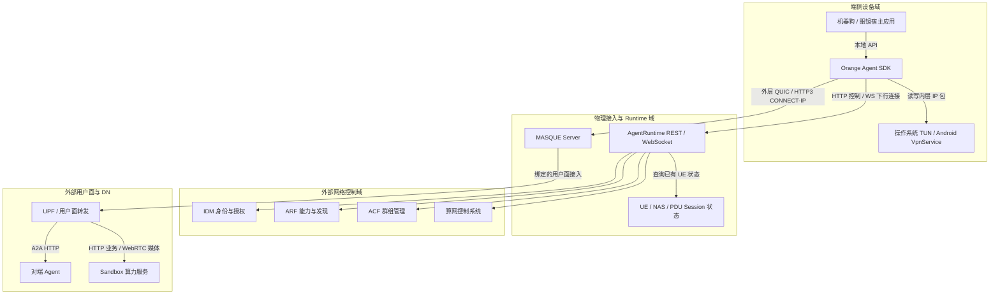

**关键说明**：

- 应用配置 Runtime IP/端口和 MASQUE URL；两者可以共址，但角色及协议不同。REST 和 WS 使用同一个 Runtime 地址，不经 `/sdk/v1/endpoints` 动态发现。
- SDK 通过 `GET /v1/ue/info` 选择恰好一个活动默认 IPv4 PDU Session，建立对应 `/32` TUN；不向 Runtime 上报或自行分配 Agent IP。
- 图中的 Runtime→核心网、MASQUE→UPF 为外部系统职责关系，内部网侧协议没有在本仓库实现。
- A2A HTTP 和绑定内 Sandbox 请求以 Agent IP 为源，经按群组/算力绑定维护的路由进入隧道。媒体使用 WebRTC，不通过 Runtime 转发视频帧。
- Android 独立 ASR/意图扩展允许调用应用提供的绝对 URL，且不要求初始化或 C-02 绑定；它是上述绑定门控的明确例外。初始化的可选 `standaloneAsrHost` 可以预置 ASR 主机路由，同时排除 Runtime/MASQUE 外层地址；独立 API 自身不强制绑定 UE 源地址，实际路径仍受 OS 路由影响。

### 2.2 逻辑功能划分

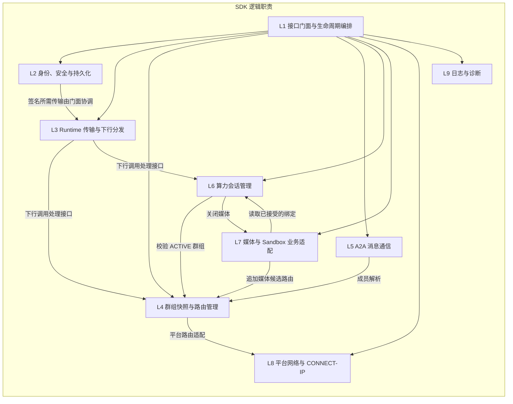

| 模块 | 职责说明 | 周边依赖 |
| --- | --- | --- |
| L1 接口门面与生命周期编排 | 参数/状态门控、初始化/关闭、监听器注册、控制流程编排 | 宿主应用；L2～L9 |
| L2 身份、安全与持久化 | Profile/Card 状态、密钥、请求签名、VC 辅助处理、本地恢复 | 文件系统/Android 私有存储；外部凭证 |
| L3 Runtime 传输与下行分发 | HTTP 调用、WS 连接/重连、信封解析、请求关联及分发 | Runtime |
| L4 群组快照与路由管理 | 成员索引、版本/失效校验、快照提交、共享路由所有权 | Runtime 下行；L8 路由实现 |
| L5 A2A 消息通信 | 出站信封、成员寻址、本地 HTTP 服务、消息去重和回调 | 对端 Agent；L4 |
| L6 算力会话管理 | C-01/C-04 状态、C-02 绑定及 C-03 确认、C-05 清理及 C-06 确认 | Runtime；L4、L7、L8 |
| L7 媒体与 Sandbox 业务适配 | producer/consumer WebRTC、识别目标、控制动作；Android 语音/意图扩展 | Sandbox、ASR/意图服务；相机/视频源 |
| L8 平台网络与 CONNECT-IP | Linux TUN/路由、Android VPN/路由、QUIC 隧道及 IP 包过滤 | 操作系统、MASQUE Server |
| L9 日志与诊断 | 请求/返回、耗时、错误、状态迁移、媒体/隧道诊断 | Python 日志文件、Android Logcat 等 |

L6 与 L7 的双向关系是运行期协作：L7 查询绑定，L6 在关闭时调用媒体清理；不能据图理解为已存在两个循环导入的代码包。当前大量 L1/L2/L4/L6/L7 编排集中于 `sdk.py` / `AgentSdk.kt`。

### 2.3 业务流程总览

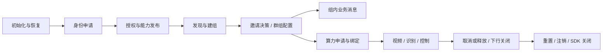

初始化只建立通信基础并恢复已有本地状态，不自动申请业务身份。身份与 Card 的申请/发布由应用显式调用；建组响应不等于群组配置已提交；算力 CREATE 接受不等于已获得可用媒体绑定。各阶段分别见 §4.1～§4.8。

## 3. SDK 4+1 视图

本章从**用例、逻辑、运行、开发、部署**五个角度描述同一套实现：用例视图定义黑盒边界与参与者；逻辑视图定义模块及接口约束；运行视图定义进程、并发和状态；开发视图将逻辑元素映射到源代码、构建和测试；部署视图说明制品如何嵌入实际设备。

### 3.1 用例视图

#### 3.1.1 上下文实体与接口关系

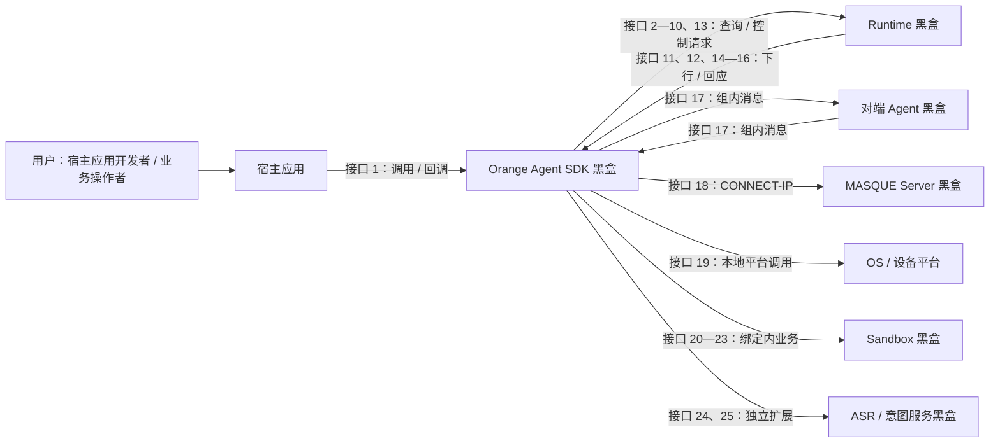

| 实体 | 类别 | 与 SDK 的关系 |
| --- | --- | --- |
| Orange Agent SDK | 本系统 | 提供端侧 Agent 接入与会话管理 |
| 宿主应用及其开发者/操作者 | 本系统的用户 | 发起调用、实现监听器、提供业务/媒体输入 |
| Runtime / MASQUE Server | 其他系统 | 控制入口、下行通道及用户面隧道入口 |
| 对端 Agent / Sandbox / ASR / 意图服务 | 其他系统 | 业务消息、算力结果和扩展推理服务 |
| OS / 设备平台 | 其他系统 | 虚拟接口、存储、网络、媒体资源的执行环境 |

**接口职责说明**：接口 1 是本地 API 与反向回调；接口 2—16 是 Runtime 上行/下行，编号不表示建立多条 WS；接口 17 是对称 A2A；接口 18 承载 IP 数据；接口 19 是平台逻辑接口；接口 20—25 是具体服务业务。详细方向与消息见 §5。

**组织边界**：SDK、宿主应用、内部通信库和测试工具属于本仓库工程维护范围；Runtime、核心网、MASQUE Server 和实际 Sandbox 是集成边界外的系统。这里描述维护和契约边界，不假设它们属于同一法人或已处于相同信任域。手机 LAN 遥控协议属于正式应用/`libs`，不纳入 SDK 周边接口编号。

| 其他暴露面 | 当前约束 |
| --- | --- |
| A2A 入站 TCP | 只绑定 Agent TUN IP，固定消息路径；并非全物理网卡监听 |
| UDP 端口 | Android 绑定配置的 Agent UDP socket，但没有业务收发/分发循环；Python 本地服务忽略 UDP 参数，不能据初始化结果宣称支持 A2A UDP |
| TUN / VPN 和 Native ABI | 涉及网络管理权限、FD 所有权及 JNI 边界；禁止将已关闭 FD 继续交给隧道 |
| 本地状态/密钥与日志 | 仅设备本地保存；日志可能包含业务字段，不能视为脱敏审计服务 |
| 媒体候选地址 | 来自 C-02 和 SDP Answer，进入按绑定维护的路由集合 |
| Android 独立 URL 输入 | 应用提供绝对 HTTP(S) URL；当前不是域名白名单或服务发现机制 |

#### 3.1.2 系统关键用例

| 用例 | 参与者 | 描述 | 接口 / 对应业务流程 |
| --- | --- | --- | --- |
| UC1 接入与恢复 | 应用、Runtime、OS、MASQUE Server | 选择 UE 地址并建立端侧网络资源，恢复本地身份 | 1、2、18、19 / §4.1 |
| UC2 身份与能力管理 | 应用、Runtime | 申请身份、网络授权、发布/更新 Card | 1、4—7 / §4.2 |
| UC3 发现和群组协同 | 应用、Runtime | 搜索 Agent、建组、接受邀请、提交/失效群组 | 1、8、9、11、12 / §4.3 |
| UC4 组内消息 | 两端应用与 SDK | 通过群组成员缓存寻址并投递 JSON | 1、17、18、19 / §4.4 |
| UC5 算力会话 | 应用、Runtime | CREATE/QUERY/CANCEL/RELEASE、版本状态与用户面绑定 | 1—3、13—16 / §4.5、§4.8 |
| UC6 视频与 Sandbox 业务 | 应用、Sandbox | 上传/接收视频、设置识别目标、提交/查询控制动作 | 1、18—22 / §4.6 |
| UC7 Android 语音/意图 | Android 应用、Sandbox/ASR/意图服务 | 绑定内音频处理及独立推理扩展 | 1、23—25 / §4.7 |
| UC8 清理与身份移除 | 应用、Runtime、OS | 等待会话关闭后重置/注销；释放 SDK 本地资源 | 1、10、13、16、19、20 / §4.8 |

### 3.2 逻辑视图

#### 3.2.1 模块关系与 Provided / Required 接口

逻辑元素沿用 §2.2 的 L1—L9，职责和依赖不另作划分。下图以接口类型补充依赖关系，外部接口详细操作仍由 §5 定义。

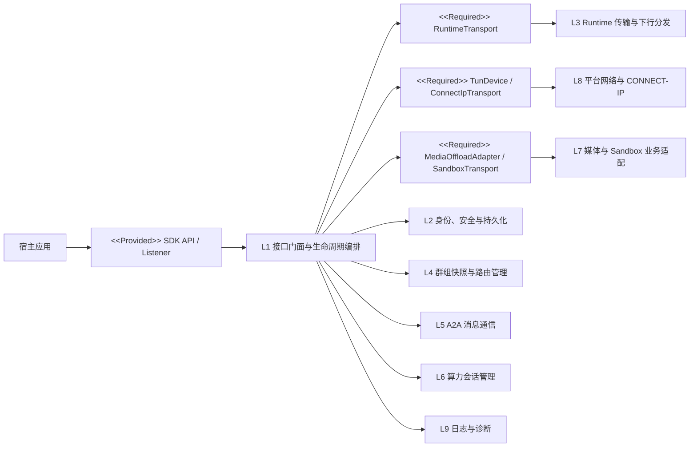

| 逻辑模块 | Provided 接口 | Required 接口 | 交互对象 |
| --- | --- | --- | --- |
| L1 | `AgentSdk` 公共 API、监听器注册及状态读取（1） | L2—L9 功能接口；应用 Listener | 应用、所有内部模块 |
| L2 | 状态读写、身份申请签名、控制 proof、测试 VC 辅助 | 本地密钥/状态存储（19）；由 L1 协调 L3 发送 | L1、平台存储 |
| L3 | `RuntimeTransport`、WS 分发入口 | HTTP/WS（2—16）；L4/L6 处理器与网络回调 | Runtime、L1/L4/L6 |
| L4 | 群组验证/提交、成员解析、按所有者替换路由 | `RouteBackend`（19）；群组消息（12） | L5/L6/L7、L8 |
| L5 | `PeerMessenger`、本地 A2A 接收（17） | 成员解析；应用群组监听器 | 对端 Agent、L4、应用 |
| L6 | 会话控制、状态/绑定查询、关闭等待 | L3（3、13—16）；L4 路由；L7 媒体清理 | Runtime、L1/L7 |
| L7 | `MediaOffloadAdapter`、视频句柄及 Sandbox 业务 API | `SandboxTransport`（20—25）；L6 绑定；L4 路由 | Sandbox、媒体源、扩展服务 |
| L8 | `TunDevice`、`ConnectIpTransport`、平台路由 | OS/VPN（19）、MASQUE（18） | L1/L4、外部平台 |
| L9 | 日志事件及诊断数据 | 日志文件/Logcat/媒体统计 | 其他模块、开发者 |

`contracts.py` 与 Android `transport/Contracts.kt` 定义主要可替换传输/平台接口；不是所有逻辑职责都已经有独立接口类。L9 是横向职责，图中省略其他模块到日志的重复连线。

#### 3.2.2 架构约束

1. **A01 依赖方向**：应用只能通过公共 API 依赖 SDK；SDK 通用能力不得反向依赖 `apps/`、`examples/` 或 `libs/remote-control`。后续巡检业务继续归属应用。
2. **A02 地址来源**：Agent IP 来自 UE 状态；成员服务 URL 来自群组快照；Sandbox URL/绑定来自 C-02。业务 API 不要求应用填写对端物理 IP、`binding_ref` 或 SDP。
3. **A03 控制入口**：IDM/ARF/ACF 操作全部由 L3 经 Runtime 发送，禁止在应用中另建绕过 SDK 状态/签名控制的同类调用。
4. **A04 路由所有权**：群组与算力绑定分别拥有路由集合，删除一个所有者不能删除仍被其他所有者引用的主机路由。快照/绑定只有在平台路由操作成功后才可发布为可用。
5. **A05 状态分离**：连接状态、持久身份状态、群组版本、算力状态版本相互独立；`READY` 不表示已有身份、Card、群组或媒体。
6. **A06 会话门控**：媒体和绑定内识别/控制调用必须引用已接受的匹配角色 C-02。独立 Android ASR/意图调用为显式例外，不得据此放宽绑定内调用。
7. **A07 关闭顺序**：存在活动/未决算力请求、绑定或媒体时，不允许清除身份；应用先取消/释放并等待关闭。SDK `close` 释放本地资源，不等同于网侧注销。
8. **A08 模型粒度**：L1—L9 是平级逻辑模块，禁止以文档子图嵌套推断新的组件层级；开发视图只映射这些元素。接口定义只在其归属模块建模一次。
9. **A09 平台隔离**：Linux 特权网络操作留在 L8，Android VPN/Native Core 留在对应适配器；高层流程不导入宿主应用的设备 SDK。

#### 3.2.3 数据与一致性模型

| 数据 | 标识/版本 | 保存位置与生命周期 | 核心一致性规则 |
| --- | --- | --- | --- |
| SDK 连接状态 | `NEW / INITIALIZING / READY / CLOSED`；Android 另有 `CLOSING` | SDK 实例内存 | 初始化失败触发本地清理；允许关闭后重新初始化 |
| Profile/Card | `schema_version=2`；三态见 §3.3 | Runtime 地址作用域的本地文件 | 状态和上下文一起持久化；恢复时校验 Runtime 和 TUN 地址 |
| 设备密钥 | P-256 消息签名；独立 Ed25519 MASQUE 证书密钥 | 设备私有存储 | 首次生成并复用；reset 不删除设备密钥 |
| 群组快照 | `group_id`、协议 `version`、整数 `group_version` | 进程内存 | 协议主版本 1；正 uint64 群组版本；同版本同业务内容幂等，低版本/同版本异内容拒绝 |
| 群组成员 | `agent_id` 索引 | 快照内存 | `members` 外层标签不作 Agent ID；`service_endpoints` 为单个绝对 URL 字符串 |
| 算力请求 | `request_id` | 进程内存 | 同 ID 同内容可关联；同 ID 异内容拒绝，HTTP 接受与 WS 状态可乱序到达 |
| 算力状态 | `compute_service_session_id`、十进制字符串 `status_revision` | 进程内存 | 按 uint64 比较，旧状态不能覆盖新状态；终态不允许晚到配置复活 |
| 算力绑定 | 会话/实例 ID、`binding_ref`、角色、接收 Agent | 进程内存 | 同配置重放幂等；同绑定异配置拒绝；PDU/DNN/切片/IP 必须匹配当前 UE |
| 媒体连接 | `media_connection_id`、`request_id`、完整 `computing_context` | SDK 句柄与服务端资源 | 校验服务端回显；协商失败清理远端已创建连接 |
| A2A 去重 | `message_id` | 接收端进程内存，最近 1024 个 | 回调成功后保留记录；失败可重试；不是跨重启的恰好一次投递 |

群组业务内容比较不将通知时间、proof、`target_agent_id` 当成成员配置变化；失效消息清理成员与路由并保留版本语义，避免旧配置复活。群组回调失败不会回滚已经提交的网络配置，重放时重试待完成回调后再确认。

Python 状态采用临时文件、同步及原子替换；目录权限 `0700`、状态文件 `0600`，默认位于 `${XDG_STATE_HOME:-~/.local/state}/agent-sdk/agents/`。Android 使用应用私有目录下的状态存储。两端均不把群组、算力绑定或媒体连接当成可跨进程恢复的持久会话。

#### 3.2.4 安全设计现状与边界

| 机制 | 当前实现 | 设计含义 |
| --- | --- | --- |
| 身份申请签名 | P-256，`ACN-H-ID-v1`；LP16 字段包含完整紧凑 metadata JSON | 与其余控制 proof 编码不同，不能混用 |
| 其他身份/能力/组网控制请求 | 分离 JWS；保留 `verification_method / proof_purpose` | 未编码载荷为 proof 摘要在前、业务摘要在后的 64 字节；`request_id` 不进入业务摘要 |
| 算力 C-01 | 当前结构化协议体 | **不附加上述控制 proof/timestamp**，不能将所有 REST 一概描述为已签名 |
| MASQUE | TLS 1.3 加密，设备独立生成 Ed25519 客户端证书/私钥 | **当前封闭内测构建关闭服务端证书链及名称校验**，不能据此宣称可靠的服务端身份认证或完整双向信任 |
| 群组下行 proof | 保留验证实现及核心网 P-256 公钥资源 | **当前默认关闭验签**；版本/结构校验仍执行 |
| A2A | 成员/目标校验、入站绑定与消息去重 | 当前 HTTP 契约不定义消息级 proof；不能描述为逐条消息验签 |
| 测试能力 VC | SDK 可用打包的测试机构 P-256 私钥现场签发 | Wheel/AAR 包含共享测试私钥，**仅限封闭联调，不能作为生产凭证方案** |
| 外部签发 VC | 调用方以 `credentials` 提供 | 原样转交，不改写签名/有效期；生产凭证来自外部签发方 |
| Runtime/A2A HTTP | 当前控制接口和对端 HTTP 依赖受控部署网络 | 不能将 MASQUE 的加密能力套用到所有 HTTP 接口 |

详细签名编码以 [Proof 生成与校验说明](../protocols/Agent-SDK-Proof生成与校验说明.md) 及安全实现为准。面向生产的证书信任、群组验签启用、测试私钥移除和端到端授权策略需要独立设计/验收；本文仅登记实现差距，不宣称已完成这些变更。

#### 3.2.5 技术模型与版本

| 技术选型 | 类型 | 当前声明版本 | 选型原则与约束 |
| --- | --- | --- | --- |
| Python / setuptools | «OpenSource» | Python ≥3.10；setuptools ≥68 | 异步库与 wheel；完整测试建议 3.11+，部分测试使用 `asyncio.timeout` |
| aiohttp / httpx | «OpenSource» | `>=3.9,<4` / `>=0.25,<1` | 本地 HTTP、WS 与异步 HTTP 客户端；受对应异常和连接生命周期约束 |
| aioquic / aiortc | «OpenSource» | `>=1.3,<2` / `>=1.14,<2` | Python QUIC/HTTP3 与 WebRTC；需要系统媒体/加密依赖可安装 |
| cryptography / pyroute2 | «OpenSource» | `>=42,<47` / `>=0.7,<1` | 密钥签名与 Linux Netlink；网络操作需要权限 |
| Gradle / Android Gradle Plugin / Kotlin | «OpenSource» | 8.7 / 8.5.1 / 1.9.24 | 根 wrapper 构建；Java/JVM 17；minSdk 26、compileSdk 34 |
| kotlinx.coroutines / serialization-json | «OpenSource» | 1.8.1 / 1.6.3 | Kotlin 异步与 JSON；SDK 对 JSON 类型存在公共依赖 |
| OkHttp / AndroidX core-ktx | «OpenSource» | 4.12.0 / 1.13.1 | HTTP/WS 和 Android 平台适配 |
| Android libwebrtc 制品 | «OpenSource» | `io.github.webrtc-sdk:android:150.7871.01` | SDK 内置媒体适配，作为 `api` 传递依赖；单独复制 AAR 时还需处理依赖 |
| Go / Android NDK | «OpenSource» | go.mod 1.25.0；脚本默认 NDK 27.0.12077973 / API 26 | c-shared 构建四种 ABI；NDK 位置可配置 |
| connect-ip-go / quic-go | «OpenSource» | 0.2.0 / 0.61.0 | 前者通过 `replace` 使用仓内补丁副本，不能直接替换为未修改上游包 |
| uritemplate / x/sys | «OpenSource» | 3.0.2 / 0.47.0 | Native URL 模板与系统接口；间接依赖以 go.mod 为准 |
| Runtime / MASQUE / Sandbox / ASR | «ThirdParty» 外部集成系统 | 仓内没有统一锁定服务端发布版本 | 必须按接口契约联调；不能从 SDK 版本推导服务版本 |

Python 表中是声明范围而非本机安装锁定版本，Android/Go 则以构建文件声明为准。升级应同时核对协议、QUIC 包容量、WebRTC SDP/ICE、ABI 和依赖测试；协议主版本不兼容时不得只放宽解析器。

### 3.3 运行视图

#### 3.3.1 部署单元与进程

| 部署单元 | 进程 | 必须/可以/不允许 | 说明 |
| --- | --- | --- | --- |
| 安装 Python wheel 的 Linux 主机/容器 | 宿主 Python Agent 进程 | 必须 | SDK 以库方式运行，不另起 SDK 守护进程 |
| 集成 AAR 的 Android APK | 宿主 App 进程 | 必须 | Kotlin、VpnService、JNI 和 Go Core 在当前清单下同进程；没有 `android:process` 拆分 |
| Linux 主机 | 多个隔离 Agent 进程/容器 | 可以 | 每个实例须隔离 TUN/端口/状态/身份及路由环境，不能共享可变资源而不隔离 |
| SDK Wheel/AAR | Runtime、MASQUE Server、核心网进程 | 不允许作为内置进程理解 | 它们是外部依赖，必须另行部署 |
| 外部服务节点 | Runtime、MASQUE、Sandbox 等进程 | 必须具备相应服务 | 具体共址方式由外部部署决定，不在 SDK 内强制 |

Android 必须获得 VPN 用户授权并启动相应前台服务。已有其他 VPN 与该 SDK 的 VpnService 是否可同时工作受系统 VPN 限制；不能假设多个 SDK VPN 实例可无隔离共存。

#### 3.3.2 架构元素与并发执行

| 架构元素 | 进程内承载 | 必须/可以/不允许 | 运行关系 |
| --- | --- | --- | --- |
| L1、L2、L4、L5、L6、L9 | Python 宿主进程 / Android App 进程 | 必须 | 状态和回调属本实例；不跨进程共享对象 |
| L3 | 同宿主进程的 HTTP 客户端、WS 接收/处理任务 | 必须 | 与 Runtime 外部进程交互；响应发送串行保护 |
| L7 | 同宿主进程的 aiortc / libwebrtc 线程及 SDK 编排 | 可以；使用媒体时必须 | 无媒体业务可不启动媒体连接 |
| L8 | Python asyncio TUN 泵 / Android VPN、JNI、Go goroutine | 必须 | Native Core 不是独立可执行服务 |
| L1—L9 | 核心网或 Sandbox 服务进程 | 不允许 | SDK 不代替服务器实现 |

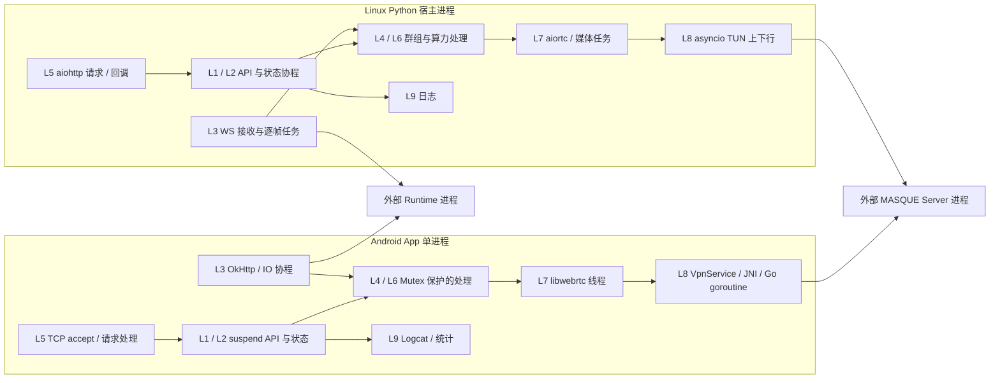

两端是可选部署形态，不要求在同一设备同时运行。Python 通过锁保护算力控制、身份移除及 A2A 去重，通过条件变量通知绑定变化；Android 使用协程/Mutex 等对应机制，阻塞网络与 Native 操作在 IO 执行域处理。应用回调须尽快返回，耗时设备动作应由应用自行编排，不能假设 SDK 自动将业务回调转发到 UI 主线程。

Android 路由变化可能重建 VPN TUN，L8 通过 FD 替换接口通知 Native Core，并重新绑定本地 A2A 服务；Go 上行循环随新 TUN FD 更新。MASQUE 断线恢复还会重新选择物理出口并协调 TUN/监听器恢复。不能只更新 Kotlin 的路由集合而让 Native Core 继续使用旧 FD。

#### 3.3.3 关键状态模型

**连接状态**与持久化业务状态分离。下图表示公共主线，Android 关闭时还经过 `CLOSING`。Python 初始化失败执行 `close` 后为 `CLOSED`，两端均应以初始化是否成功及返回结果判断接入结果，不能用本地已保存 Profile 推断网络可用。

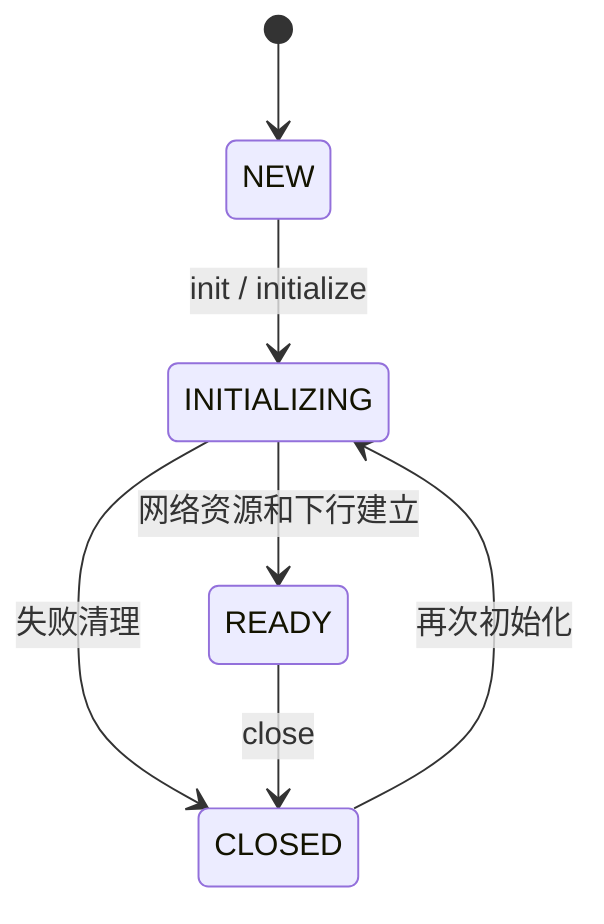

**身份状态**表示本地保存的业务进度，不把群组和算力状态合并进去。

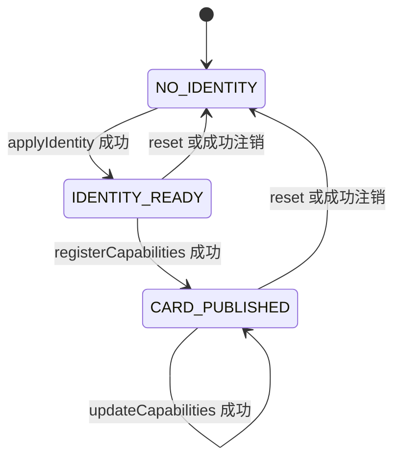

已有 `IDENTITY_READY` 再申请身份时先注销旧身份再申请；`CARD_PUBLISHED` 不允许直接重新申请。已发布 Card 再调用完整注册会经注销、重新申请和凭证重绑定后再发布，可能更换 Agent ID；无法为新身份重新签发的外部凭证会导致该路径失败，不能把它当作普通增量更新。增量操作应使用 `update_capabilities/updateCapabilities`。

**算力可用性**分成请求状态和本地绑定，下面是资源门控模型，不是对所有网侧状态迁移顺序的承诺。

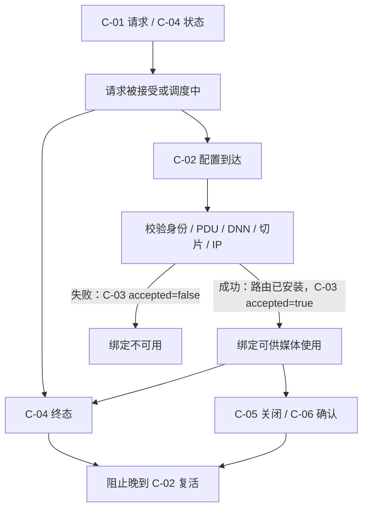

实际 C-04 状态集合见 §5.3.13；绑定下行与 HTTP 响应可能乱序，SDK 按请求关联、状态版本和关闭记录处理。C-04 `ACTIVE` 本身不代替 C-02 网络绑定，网侧终态也不能代替应用等待本地资源关闭。

#### 3.3.4 失败、恢复与容量边界

| 特性 | 当前行为 | 调用方应遵守的边界 |
| --- | --- | --- |
| WS 断线 | Python 退避从 0.5 s 到最大 10 s；Android 默认 1 s 到最大 30 s；重连后查询已知未终结 CREATE 的状态 | 不是跨进程恢复；不能承诺自动重建所有群组/媒体 |
| MASQUE 断线 | Python 一轮最多尝试 5 次重建 QUIC/HTTP3；Android 监测 Native 状态并协调 TUN、出口与监听器重建 | 与 WS 恢复独立；不承诺断线期间 IP 包无损缓存 |
| A2A 重试 | Python 默认发送一次；Android 对部分 IO 失败按 100/250/500/1000 ms 退避且受总超时限制 | 不重试业务拒绝；应用超时不能推断对端未执行 |
| A2A 回调 | 完成后返回成功；失败允许重复消息再次处理 | 使用 task/message ID 做业务幂等，去重窗口不跨重启 |
| 媒体创建 | 使用同一请求内容处理可重试传输异常；校验回显并回滚失败资源 | 无法把多个尝试简单等同于一个固定总耗时 |
| 超时 | 常规公开请求参数最低 20 s；Python Runtime 默认 30 s；Android Runtime 将过小的连接/读写超时提升到至少 20 s；视频协商/音频常见默认 120 s | 属 API 配置或步骤等待，不是端到端 SLA |
| 本地 HTTP | Python 和 Android 请求体上限 1 MiB；Android 首部上限 16 KiB | 不将大文件/音视频帧塞入 A2A JSON |
| Android 音频 | 文件非空、最大 50 MiB，支持 wav/mp3/m4a/flac/ogg/webm | 上传前完成录音；SDK 不负责 UI 录音状态 |
| 路由与包过滤 | 主机路由集合；上下行检查 IP 包长度、地址及允许集合 | 不是通用路由器，也不提供任意目的地址的全流量 VPN |
| 关闭竞争 | C-05 中止待协商媒体、清理已建立媒体及绑定路由；重复关闭回显既有结果 | 晚到协商结果不能重新发布已关闭会话 |
| 并发/过载 | 使用异步任务及锁，存在局部大小限制 | 未定义统一 WS 背压、全局并发上限或限流 SLA，部署需单独压测 |

### 3.4 开发视图

#### 3.4.1 代码模型与归属

代码仓标识：`orange_sdk`，远端 `git@github.com:acore2026/orange_sdk.git`，本地根目录 `/home/acn/cxr/orange_sdk`，类型为多应用/多平台 SDK 单仓。下表所有 L 编号均**引用 §3.2 逻辑元素**，不是新增模块。

| 逻辑架构元素 | Python 代码目录/文件（相对 `sdks/python/src/agent_sdk/`） | Android 代码目录/文件（相对 `sdks/android/`） |
| --- | --- | --- |
| L1 | `sdk.py`、`__init__.py`、`models.py`、`contracts.py`、`config.py` | `src/main/kotlin/com/rayneo/agent/sdk/AgentSdk.kt`、`model/`、`transport/Contracts.kt` |
| L2 | `agent_state.py`、`identity.py`、`security.py`、`capability_vc.py`、`certs/`；部分编排在 `sdk.py` | Kotlin `state/`、`security/`、`model/AgentLifecycleState.kt`；Native `core/identity.go`；部分编排在 `AgentSdk.kt` |
| L3 | `runtime.py`、`sdk.py` 下行分发 | Kotlin `transport/OkHttpTransports.kt`、`AgentSdk.kt` 下行分发 |
| L4 | `group_cache.py`、`routes.py`、`sdk.py` 群组提交 | Kotlin `group/GroupMemberCache.kt`、`vpn/AgentVpnService.kt` 路由、`AgentSdk.kt` |
| L5 | `rest_server.py`、`runtime.py` 的 PeerMessenger、`sdk.py` A2A | Kotlin `server/TcpJsonLocalServer.kt`、`transport/OkHttpTransports.kt`、`AgentSdk.kt` |
| L6 | `sdk.py` 算力控制和状态/绑定处理、`models.py` | Kotlin `AgentSdk.kt` 算力控制、`model/Models.kt` |
| L7 | `webrtc.py`、`rtc_policy.py`、`camera.py`、`sdk.py` Sandbox 编排 | Kotlin `webrtc/AndroidWebRtcMediaAdapter.kt`、`model/RuntimeAudioResult.kt`、`AgentSdk.kt` |
| L8 | `tun.py`、`masque.py`、`routes.py` 平台后端 | Kotlin `vpn/`、`masque/`、`transport/RouteLocalAddressResolver.kt`；`native/masque_core/`、`src/main/jniLibs/` |
| L9 | `logging_utils.py`、`video_diagnostics.py` 及各模块日志 | Kotlin/Go 各模块日志、MASQUE 统计接口；应用日志导出归应用所有 |

上表 Android 的 `model/`、`state/`、`security/` 等简写均位于 `src/main/kotlin/com/rayneo/agent/sdk/`。接口与代码的关键映射为：接口 1→L1；2—16→L3 和 L1/L2/L4/L6 处理代码；17→L5；18—19→L8/L2；20—25→L7。详细 API 参数见模块 README，本文避免重复维护全部语言签名。

```text
orange_sdk/
├── apps/                     # 正式应用：机器狗、眼镜、手机
├── sdks/
│   ├── python/               # wheel、src/agent_sdk、单元测试
│   └── android/              # AAR、Kotlin、Go/JNI、单元测试
├── libs/remote-control/      # 正式应用间的内部通信库
├── examples/                 # Python / Android SDK 接入示例
├── mock-service/             # Mock 服务及周边配套
├── integration-tests/        # 跨组件契约与完整场景
├── tools/                    # device / diagnostics / release
└── docs/                     # architecture / protocols / deployment / assets
```

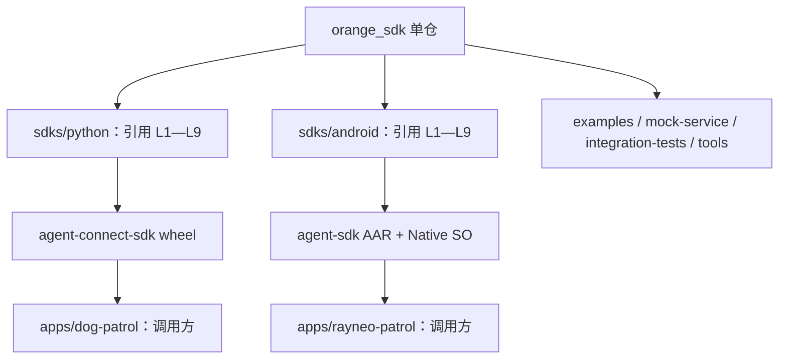

后续新增代码的落点：通用跨业务 API/协议与平台适配放 `sdks/`；设备巡检、动作、展示和任务策略放 `apps/`；应用遥控复用放 `libs/remote-control`；周边模拟与配套放 `mock-service/`；跨组件契约放 `integration-tests/`；跨模块维护脚本放 `tools/`。完整目录准则见 [代码组织与功能归属](REPOSITORY_LAYOUT.md)。

#### 3.4.2 跨平台 API 能力对应

| 能力 | Python | Android |
| --- | --- | --- |
| 接入/关闭 | `init` / `close` | `initialize` / `close` |
| 监听器 | `register_network_message_listener`、`register_group_message_listener` | 对应 `registerNetworkMessageListener`、`registerGroupMessageListener` |
| 身份/本地状态 | `apply_identity`、`deregister_identity`、`reset_agent`、`set_local_profile_for_restore` | `applyIdentity`、`deregisterIdentity`、`resetAgent`、`restoreLocalProfile` |
| 授权/能力 | `get_network_ability`、`register_capabilities`、`update_capabilities` | 对应 camelCase API |
| 发现/建组/消息 | `discover_agents`、`create_group`、`send_message`、`get_group_snapshot` | 对应 camelCase API |
| 算力生命周期 | `create/query/cancel/release_computing_session`、`await_computing_session_closed` | `create/query/cancel/releaseComputingSession`、`awaitComputingSessionClosed` |
| 视频 | `start_video_upload`、`get_processed_video_stream` | `startVideoUpload`、`getProcessedVideoStream` |
| 识别目标/控制动作 | `update/get_recognition_target`、`create/get_control_action` | 对应 camelCase API |
| 群组本地丢弃 | `discard_groups`，可用于外部 ACF 重启后的显式清理 | 不假设存在同名公共能力 |
| 语音/意图扩展 | 当前无对应公开 API | `recognizeRuntimeAudio`、`createAudioControlAction`、`transcribeAudio`、`transcribeDiscoveryAudio`、`recognizeIntent` |
| 平台诊断/外部接入点 | Python 日志与适配接口 | `getMasqueTransportStatistics` 及群组/A2A 处理入口等；不代表应用应自行拼网侧消息 |

Python Listener 还支持完整信封 `on_group_envelope`；旧形式回调只传群组 ID、发送者 ID 和业务 payload。不要依赖两端所有扩展 API 或回调参数完全相同。

#### 3.4.3 构建模型

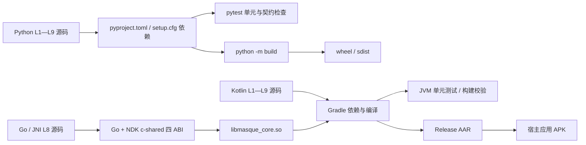

该图是构建/验证依赖说明，不宣称已经配置了统一 CI 流水线或额外静态扫描任务。Native SO 已随代码提供，Gradle `preBuild` 校验四 ABI 文件存在；重编译 Native 使用 `build-android.sh`，并非每次 Gradle 自动重建。

| 构建项 | 环境与依赖管理 | 命令 / 产物 |
| --- | --- | --- |
| Python SDK | Linux、Python/pip、setuptools；配置见 `setup.cfg`、`pyproject.toml` | 根目录 `python3 -m build sdks/python`；`sdks/python/dist/` |
| Python 验证 | 安装 `./sdks/python[test]`；完整测试优先 Python 3.11+ | 根目录 `python3 -m pytest -q`；可单独指定 SDK tests |
| Android SDK | JDK 17、Android SDK 34、根 Gradle wrapper | `./gradlew :agent-sdk:testDebugUnitTest :agent-sdk:assembleRelease` |
| Native Core | Go 工具链、NDK，go.mod + 仓内 connect-ip-go 补丁 | `bash sdks/android/native/masque_core/build-android.sh`；四 ABI SO |
| 消费验证 | 应用及示例 Gradle 工程 | `:example-app`、`:phone-controller` 等；不是 SDK 发布版本来源 |

1. **B01 必须**从仓库根使用 Gradle wrapper；项目 ID 仍是 `:agent-sdk`，目录由 `settings.gradle.kts` 映射，不重新引入旧 `android/` 根工程。
2. **B02 必须**在 Native 修改后重建所需 ABI 并检查 AAR 内容；仅通过 Kotlin 编译不能证明 SO 与源码一致。
3. **B03 可以**通过可替换传输/媒体适配运行离线测试；禁止把测试服务依赖加入正式 SDK 运行依赖。
4. **B04 必须**保留 wheel 的 `py.typed` 和资源、AAR 的 JNI 与 consumer rules；单个 AAR 文件不等于已打包所有 Maven 依赖。
5. **B05 禁止**从应用版本号推导 Android SDK 版本；Android SDK 当前需结合构建基线/制品记录标识。

#### 3.4.4 测试模型

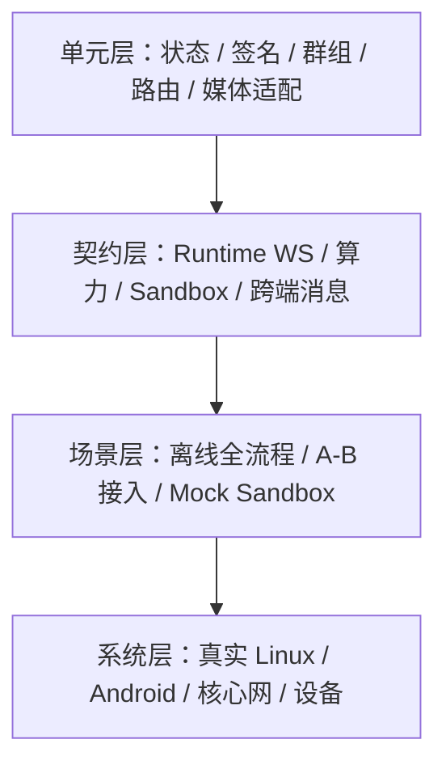

| 层次 | 代码位置 | 验证重点 |
| --- | --- | --- |
| SDK 单元测试 | `sdks/python/tests/`、`sdks/android/src/test/` | 生命周期、签名、版本冲突、绑定、清理竞争、ICE 候选和平台边界 |
| 跨组件契约 | `integration-tests/contracts/` | 周边协议、业务语音等跨模块一致性；具体可用环境以各测试为准 |
| 场景与 Mock | `integration-tests/scenarios/`、`examples/python/tests/`、`mock-service/mock-sandbox/tests/` | 完整调用顺序、A/B 互通、Mock 媒体服务 |
| 应用测试 | `apps/`、`libs/remote-control/` 各自测试 | 巡检状态、应用遥控和展示等；不是 SDK API 单元测试 |
| 真机/性能 | 设备部署及诊断工具 | VPN 权限、摄像头/编解码、网侧绑定、吞吐/丢包/时延等实际约束 |

1. **T01** 用已有传输、TUN、路由、媒体适配接口隔离外部网络，不通过生产代码开关绕过协议门控。
2. **T02** 必须覆盖重复、乱序、晚到关闭、绑定冲突和协商回滚，不能只验证成功返回。
3. **T03** Mock/离线通过只能证明对应模拟契约，不等于真实核心网、真机媒体或生产安全验收。
4. **T04** 测试跨语言扩展时按 §3.4.2 区分能力，不要求 Python 实现 Android 专用服务。

本文新增工作仅为设计文档与导航，不重跑业务回归、不将既有测试结果作为本次重新验收结果。

### 3.5 部署视图

#### 3.5.1 部署节点与关系

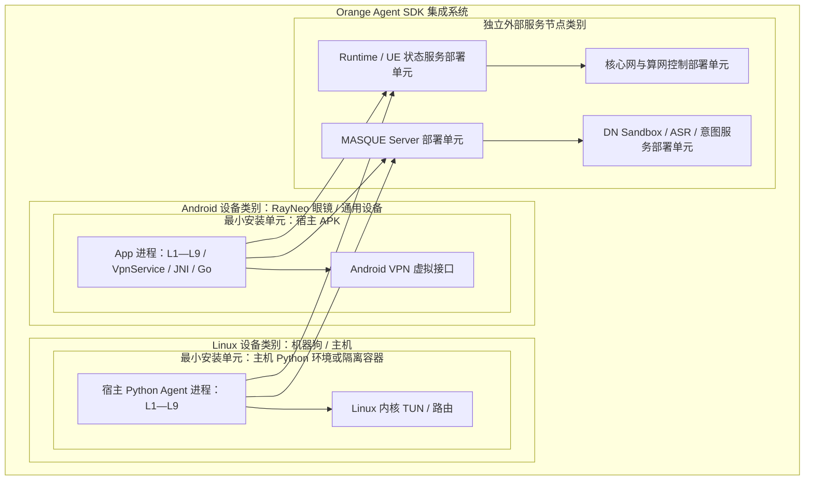

外部节点表示依赖类别，不约束为 VM、Pod 或容器；SDK 本身没有 Kubernetes 控制器、服务端伸缩或云化编排实现。Linux 可容器化，Android 通过 APK 安装及系统 VPN 授权运行。

#### 3.5.2 部署约束

| 约束 | 类型 | 说明 |
| --- | --- | --- |
| Linux TUN 和网络权限 | 必须 | `/dev/net/tun` 可用；具备创建接口/路由所需 root 或相应能力；容器需设备和网络权限 |
| Android 运行平台 | 必须 | API ≥26；APK ABI 与设备匹配；授予 VPN，遵循当前前台服务清单及宿主权限 |
| 用户面绑定 | 依赖 | Runtime 已有 NAS 注册、安全上下文、`session_ready` 和活动默认 IPv4 PDU Session |
| 物理网络可达 | 依赖 | Runtime HTTP/WS 可达；MASQUE QUIC UDP/HTTPS 入口可达；绑定用户面可达 Sandbox |
| VPN 出口保护 | 必须 | Android 外层 QUIC socket 经 VpnService protect，避免外层连接递归进入 TUN |
| 本地端口、TUN、身份/存储 | 必须隔离 | 多实例不能无约束共享；Agent IP 由网侧会话确定，不任意静态复用 |
| 状态目录 | 必须 | 写入持久可用且访问受限的位置；容器若需跨重启恢复应挂载相应目录 |
| 现有 VPN | 互斥/受系统限制 | Android 不承诺与任意其他 VPN 同时运行 |
| 服务端进程打进 SDK | 禁止 | SDK 交付端侧库，不能代替部署外部 Runtime/MASQUE/核心网 |
| 当前内测安全 Profile | 禁止直接作为生产方案 | 证书校验、群组验签及测试私钥问题见 §3.2.4 |

#### 3.5.3 真实交付模型

| 交付件 | 包含制品 / 版本 | 适用场景 | 说明 |
| --- | --- | --- | --- |
| Python SDK | `agent_connect_sdk-0.17.11-*.whl`；源码包；`agent_sdk` 及 PEM 资源 | Linux 宿主 Python 应用 | `agent-sdk-self-check` 控制台入口；依赖按 pip 元数据安装，不包含 Python 解释器 |
| Android SDK | `sdks/android/build/outputs/aar/agent-sdk-release.aar` | Android/RayNeoOS APK 集成 | Kotlin/Java 类、Manifest、资源、consumer rules；四 ABI `libmasque_core.so` |
| Android SDK Native 库 | arm64-v8a、armeabi-v7a、x86_64、x86 SO | AAR 内置组成部分 | Go/JNI；当前无独立面向应用的服务进程/独立版本号 |
| 接入资料 | SDK README、本设计文档、Proof 文档及 `examples/` | 集成开发与联调 | 文档与源码基线共同标识协议；不将应用 APK 当作 SDK AAR |
| 周边配套（可选） | `mock-service/mock-sandbox`、Linux A/B 示例镜像与工具 | 离线/集成验证 | 不作为 SDK 自动安装的生产服务 |

Android AAR 没有独立语义版本配置，交付时应记录 Git 基线、构建时间和制品校验值；本设计文档不虚构已存在的 SDK 发布号。实际依赖版本见 §3.2.5。

#### 3.5.4 真实部署模型与部署规格

| 进程 | 部署单元 | 承载逻辑元素 | deploymentLocation | executionLocation |
| --- | --- | --- | --- | --- |
| 机器狗/其他 Linux Python Agent | 主机虚拟环境或容器 | L1—L9 | 环境 `site-packages/agent_sdk/`；业务脚本由应用部署 | 宿主 Python 进程、asyncio 与媒体执行任务 |
| 眼镜或通用 Android App | APK | L1—L9 | APK 内 SDK 类/资源和 `lib/<abi>/libmasque_core.so`；状态位于应用私有目录 | App 单进程、IO 协程、VpnService、JNI/Go 与 libwebrtc 线程 |
| Runtime | 外部安装单元 | 不承载 SDK 元素 | 外部部署配置指定 | Runtime 服务进程 |
| MASQUE Server | 外部安装单元 | 不承载 SDK 元素 | 外部部署配置指定 | QUIC/CONNECT-IP 服务进程 |
| Sandbox / ASR / 意图服务 | 外部安装单元 | 不承载 SDK 元素 | 外部部署配置或 C-02 服务地址 | 外部推理/媒体服务进程 |

**DeploymentSpecification**：Linux 默认 MTU 为 1280，具体端口、Runtime IP、MASQUE URL、日志路径和状态目录为安装/运行参数；Android 同样由应用配置，外层出口默认由 SDK 根据 MASQUE 目的地址选择，兼容参数 `localVlanIp` 仍允许显式覆盖。Android 可选 ASR 主机路由见 §2.1。这里不给出虚构的固定 CPU/内存最低规格：控制业务与视频编解码负载不同，应按分辨率、编码器、并发和目标设备实测确定。当前初始化选择 IPv4，不因群组路由层具有 `/128` 支持就承诺完整 IPv6 接入。

## 4. 业务流程

本章将关键用例展开为时序。图中 SDK 内的 L 编号引用 §3.2；外部网络内部调度不作实现展开。每条流程都按当前代码可观察行为说明成功、拒绝和清理路径。

### 4.1 初始化、地址选择与本地恢复

触发链路为应用注册监听器 → SDK 初始化 → 查询 UE → 创建端侧网络 → 建立下行连接。Linux 与 Android 的平台步骤不同，但都要求网侧已有可用 UE 会话。

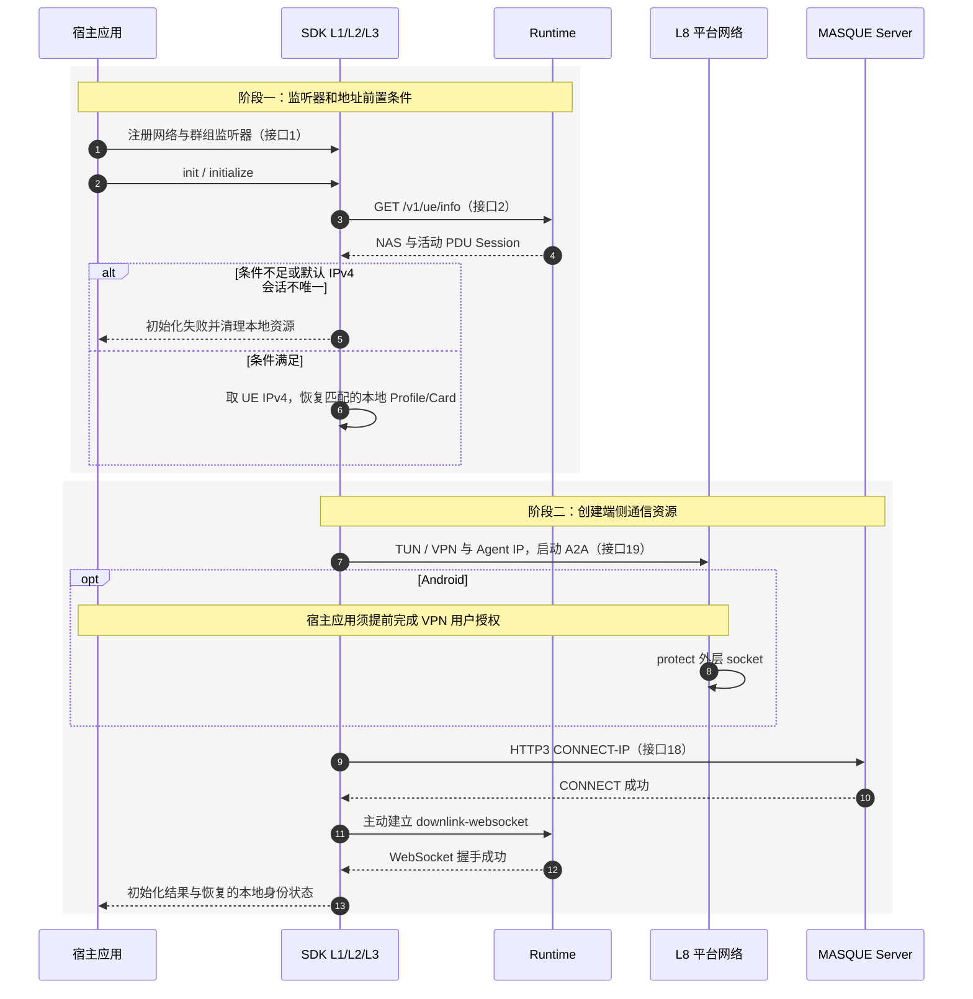

**流程小结**：**初始化**解决的是端侧网络接入与状态恢复，不自动办理身份或能力发布。

- **地址**：只使用 Runtime 的 UE IPv4，TUN CIDR 为 `/32`。
- **连接**：REST 与 WS 同址；本地 HTTP 只保留 A2A 入站。
- **恢复**：恢复 Profile/Card，不恢复群组、算力绑定或媒体连接。
- **失败**：任一步骤失败清理已分配本地资源，应用不得继续发业务请求。

### 4.2 身份申请、授权与能力发布

触发链路为应用显式申请 → SDK 设备签名 → Runtime 转交身份服务 → 保存 Profile → 获取网络能力并发布 Card。凭证既可由外部提供，也可在封闭联调中由 SDK 测试签发器生成。

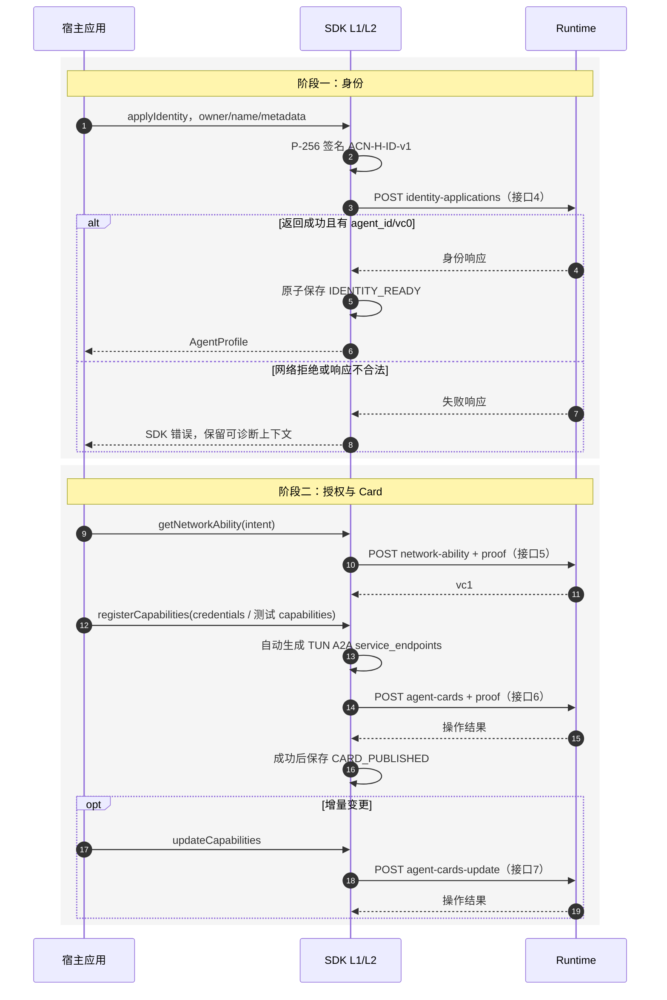

**流程小结**：**身份与能力发布**解决的是 Agent 的可识别、可授权和可发现问题。

- **密钥**：应用提供业务资料，SDK 生成/复用设备密钥并组装签名。
- **端点**：发布地址来自本机 TUN 和监听端口，应用不拼接服务 URL。
- **持久化**：成功的 Profile/Card 与申请上下文一起保存，用于恢复与身份替换。
- **更新**：已发布后的完整重新注册可能替换身份；通常增量修改走更新 API。
- **凭证**：测试签发器仅用于封闭联调；预签发 VC 保持原样。

### 4.3 发现、建组、邀请与配置提交

触发链路为发现候选 → 发起建组 → 对端应用决定接受 → 网侧下发群组 → SDK 安装路由并提交快照。建组请求的 `dnn` 必须非空。

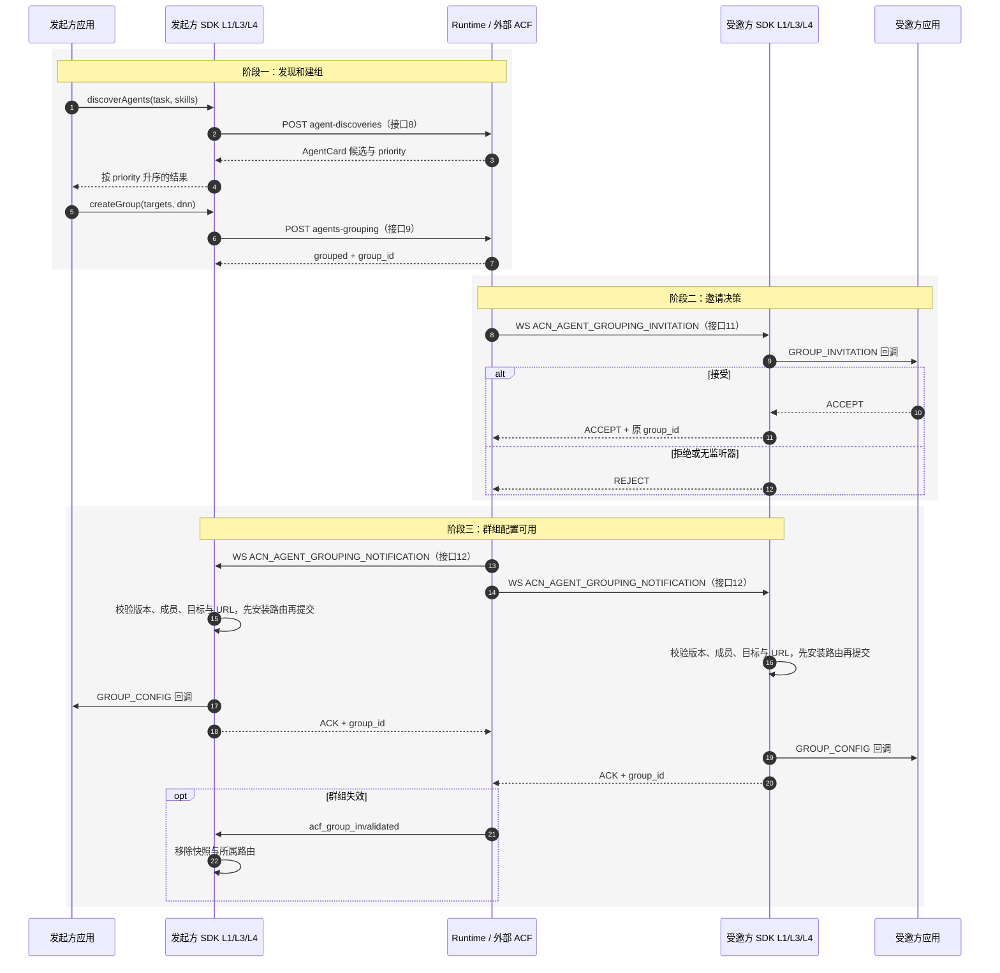

**流程小结**：**发现与建组**解决的是按能力选择 Agent，并形成可用于通信的群组成员视图。

- **状态**：`grouped` 是网侧建组结果，ACTIVE 需有效配置提交；配置可能先于建组 HTTP 响应到达。
- **邀请**：由应用做接受/拒绝决策；没有网络监听器时拒绝邀请。
- **版本**：同版本同内容可重放，旧版本或冲突内容拒绝；不能用时间戳代替 `group_version`。
- **提交**：路由成功在先，快照发布在后；通知回调失败时保留已提交配置并允许重放重试。
- **失效**：清除群组所属路由，不能回退到应用提供的物理地址继续发送。

### 4.4 组内 A2A 消息

触发链路为应用给出群组和目标 Agent → SDK 缓存解析 → HTTP 消息经用户面发送 → 对端校验、去重并回调。SDK 传输业务 JSON，不解释巡检指令。

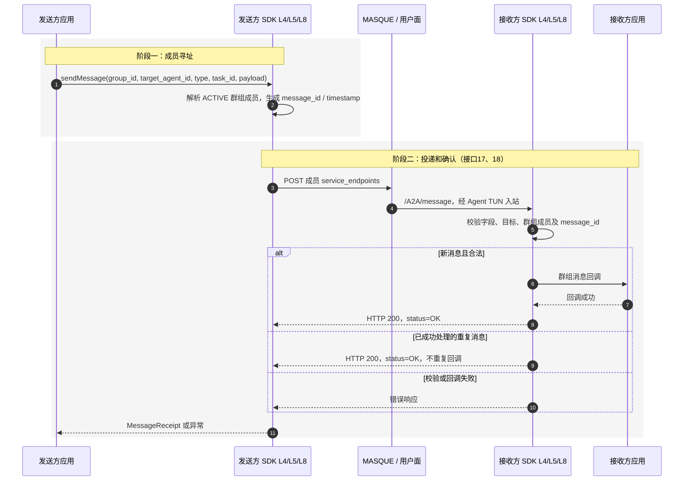

**流程小结**：**A2A 投递**解决的是按 Agent ID 发送业务消息并获得接收处理结果。

- **传输**：SDK 使用配置中的完整 URL 和 Agent 主机路由，不要求应用传 IP。
- **信封**：包含消息、群组、源/目标 Agent、类型、任务和时间戳等字段。
- **确认**：成功响应表示对端消息回调完成，不等同于机器狗动作或巡检任务最终完成。
- **幂等**：有限内存去重；网络超时和进程重启仍要求应用的任务协议具备幂等性。

### 4.5 算力申请、状态与用户面绑定

触发链路为 ACTIVE 群组 → C-01 CREATE → C-04 异步状态 → C-02 配置 → 本地校验与路由安装 → C-03 确认。C-02 与 HTTP/C-04 可以乱序，图中仅展示一种成功顺序。

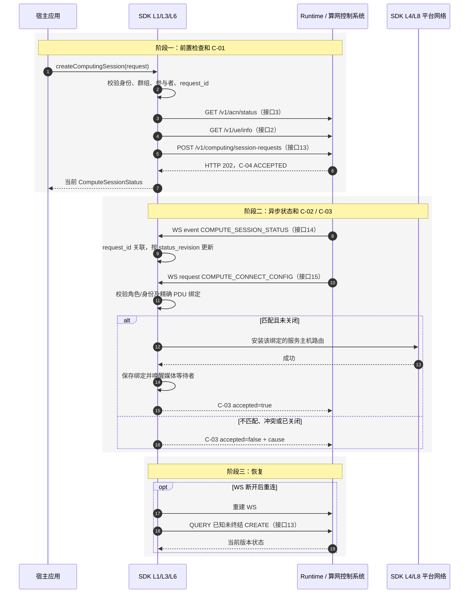

**流程小结**：**算力绑定**解决的是将异步分配的服务与本地真实 UE 用户面准确关联。

- **控制与数据**：CREATE 不返回供应用使用的 Sandbox URL；SDK 内部处理 C-02。
- **精确绑定**：PDU ID、DNN、切片、UE IPv4 和接收 Agent 必须匹配，不能借用另一业务会话。
- **状态版本**：旧 HTTP 响应不能覆盖已收到的较新 WS 状态。
- **可用条件**：媒体等待 C-02 成功，不把 C-04 `ACTIVE` 当作完整网络配置。
- **恢复范围**：重连查询恢复已知请求的状态，不保证重启后恢复服务端未决资源。

### 4.6 视频卸载、识别目标与控制动作

触发链路为有效 C-02 → 本地非 Trickle Offer → Sandbox 创建媒体连接 → 校验回显并应用 Answer → 媒体传输。识别/控制为同一已绑定服务上的独立业务请求。

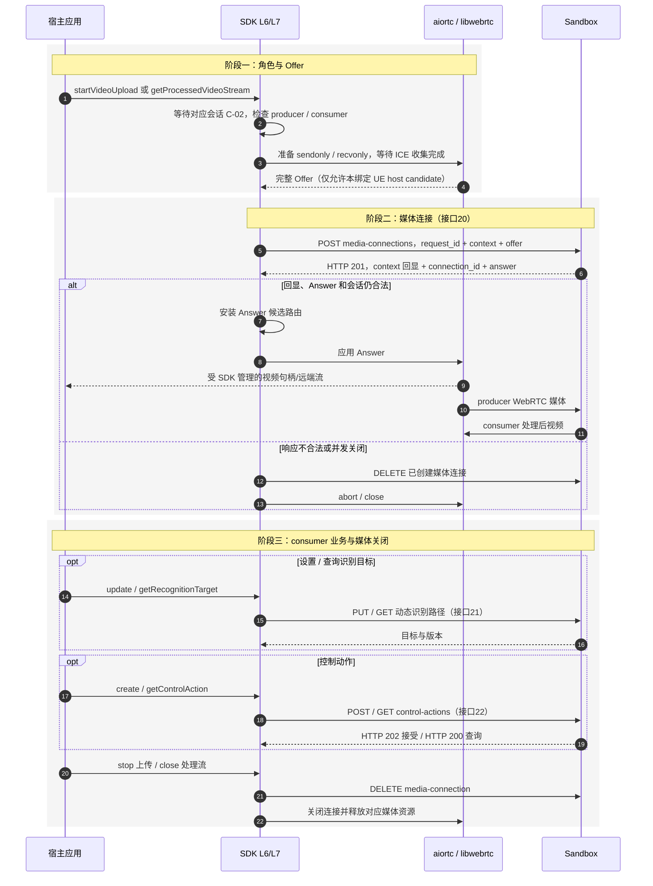

**流程小结**：**媒体与 Sandbox 业务**解决的是在正确用户面绑定上完成视频处理和业务交互。

- **角色**：producer 上传、consumer 接收，方向不可互换；识别与控制要求 consumer。
- **封装**：应用不处理 SDP、Sandbox 地址、媒体连接 ID 或 `binding_ref`。
- **校验**：严格校验 request/context 回显、201 状态和 Answer，再发布媒体句柄。
- **业务**：SDK 传递识别/动作契约，不直接控制机器狗硬件；控制请求接受也不等于动作已执行。
- **释放**：停止媒体会删除该媒体资源，但不自动等同于释放整个算力会话。

### 4.7 Android 语音与意图扩展

触发链路分为绑定内音频处理与独立服务调用。这里的录音、业务确认、运动执行属于宿主应用，SDK 只上传音频/文本并解析响应。

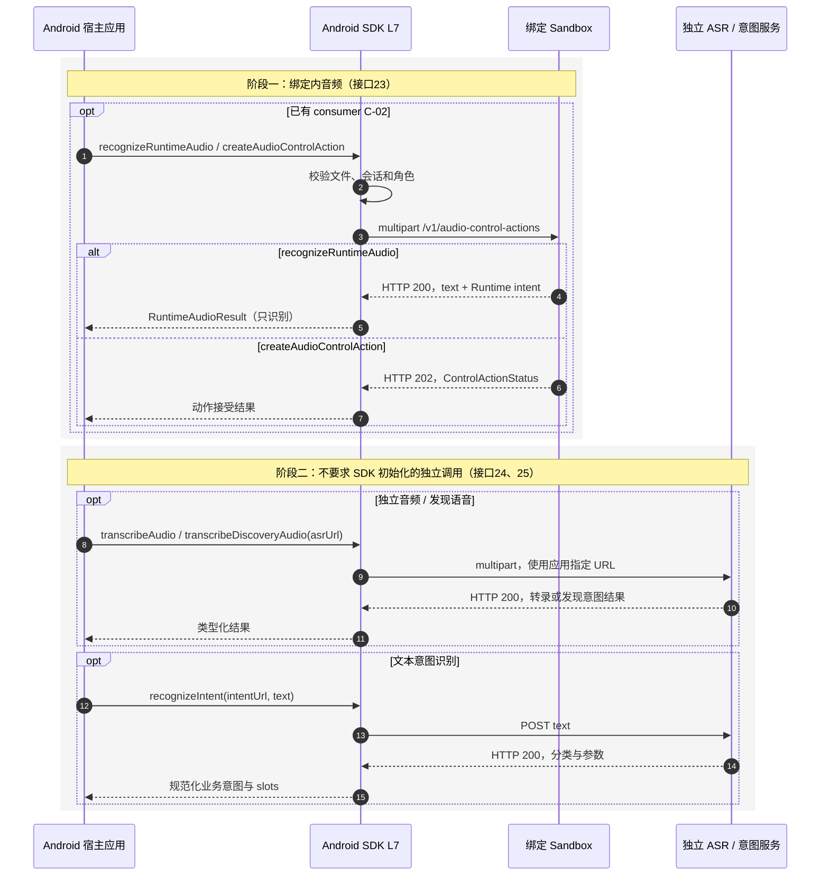

**流程小结**：**Android 语音/意图扩展**解决的是将语音和文本服务结果转换为应用可消费的类型。

- **实现差异**：Python 当前无对应公开 API；不能当成全平台共有能力。
- **绑定内模式**：两种调用使用同一路径但期待不同响应，必须与外部服务实际模式匹配；Mock 的 202 不满足 `recognizeRuntimeAudio` 的 200 契约。
- **独立模式**：应用指定 URL，不要求初始化或 C-02，SDK 不绑定 UE 源地址。
- **执行边界**：`recognizeRuntimeAudio` 只做识别；应用自行决定确认、派遣和硬件动作。

### 4.8 会话关闭、重置、注销与 SDK 释放

触发链路为停止业务 → CANCEL/RELEASE → Runtime 下发 C-05 → SDK 清理并返回 C-06 → 等待本地关闭完成 → 按需重置或注销身份。应用退出还需显式释放 SDK。

```mermaid
sequenceDiagram
    autonumber
    participant APP as 宿主应用
    participant SDK as SDK L1/L2/L6/L7
    participant RT as Runtime
    participant SB as Sandbox
    participant OS as L4/L8 平台资源
    rect rgb(245, 245, 245)
        Note over APP,RT: 阶段一：网侧取消 / 释放（接口13）
        APP->>SDK: cancel 请求 / release 会话
        SDK->>RT: C-01 CANCEL / RELEASE
        RT-->>SDK: C-04 状态（不代表已清理）
        APP->>SDK: awaitComputingSessionClosed
    end
    rect rgb(245, 245, 245)
        Note over SDK,OS: 阶段二：本地关闭（接口16、20、19）
        RT->>SDK: C-05 COMPUTE_SESSION_CLOSE
        SDK->>SDK: 匹配绑定，阻止晚到媒体协商
        SDK->>SB: 尝试删除媒体连接
        SDK->>SDK: abort / stop / close 本地媒体
        SDK->>OS: 移除该绑定路由
        SDK->>SDK: 移除绑定并保存关闭结果
        SDK-->>RT: C-06 closed=true / false + cause
        SDK-->>APP: 关闭等待完成或超时
    end
    rect rgb(245, 245, 245)
        Note over APP,RT: 阶段三：身份与 SDK 生命周期
        alt 仅清除本地 Profile/Card
            APP->>SDK: resetAgent（接口1）
            SDK->>SDK: NO_IDENTITY，保留设备密钥，不发 HTTP
        else 网侧身份注销
            APP->>SDK: deregisterIdentity
            SDK->>RT: POST agent-deletions（接口10）
            RT-->>SDK: 成功后清除本地 Profile/Card
        end
        opt 退出 SDK
            APP->>SDK: close
            SDK->>OS: 停止服务、隧道、TUN/VPN 与本地资源
        end
    end
```

**流程小结**：**资源关闭与身份移除**解决的是避免业务网络资源仍活动时身份被提前清除。

- **等待**：释放请求返回不等于资源已关闭，须等待本地 C-05 清理结果。
- **幂等**：重复 C-05 回带已记录结果；绑定不匹配拒绝，不能误清另一会话。
- **失败收敛**：远端媒体 DELETE 失败时本地仍尝试关闭，外部资源收敛还依赖网侧清理，不能宣称一个 ACK 保证所有服务器资源已消失。
- **区别**：reset 只清本地；deregister 访问网侧；close 是本地运行资源释放，三者不能互相代替。
- **门控**：活动或未决算力资源存在时重置/注销失败并保留身份，应用先完成清理再重试。

## 5. 周边接口

本章给出本地 API、Runtime、A2A、隧道/平台及 Sandbox/扩展服务的完整接口分组。编号是本文唯一权威清单，同一 WS 连接上的不同消息拥有不同功能编号，并不表示不同网络端口。

### 5.1 接口清单

| 编号 | 调用方 | 提供方 | 接口功能 | 对应业务流程 |
| --- | --- | --- | --- | --- |
| 1 | 宿主应用；SDK 反向回调 | SDK；宿主 Listener | 本地公共 API、回调、状态与视频句柄 | §4.1—§4.8 |
| 2 | SDK | Runtime | `GET /v1/ue/info` 查询 UE/PDU | §4.1、§4.5 |
| 3 | SDK | Runtime | `GET /v1/acn/status` 算力前置检查 | §4.5 |
| 4 | SDK | Runtime | `POST /idm/v1/identity-applications` 身份申请 | §4.2 |
| 5 | SDK | Runtime | `POST /idm/v1/network-ability` 网络能力授权 | §4.2 |
| 6 | SDK | Runtime | `POST /arf/v1/agent-cards` 能力发布 | §4.2 |
| 7 | SDK | Runtime | `POST /arf/v1/agent-cards-update` 能力更新 | §4.2 |
| 8 | SDK | Runtime | `POST /arf/v1/agent-discoveries` 发现 | §4.3 |
| 9 | SDK | Runtime | `POST /acf/v1/agents-grouping` 建组 | §4.3 |
| 10 | SDK | Runtime | `POST /acn-agent/v1/agent-deletions` 注销 | §4.8 |
| 11 | Runtime | SDK；SDK 回应 Runtime | WS `ACN_AGENT_GROUPING_INVITATION` 邀请 | §4.3 |
| 12 | Runtime | SDK；SDK 回应 Runtime | WS `ACN_AGENT_GROUPING_NOTIFICATION` 配置/失效 | §4.3 |
| 13 | SDK | Runtime | `POST /v1/computing/session-requests` C-01 / C-04 | §4.5、§4.8 |
| 14 | Runtime | SDK | WS event `COMPUTE_SESSION_STATUS` C-04 | §4.5、§4.8 |
| 15 | Runtime | SDK；SDK 回应 Runtime | WS request `COMPUTE_CONNECT_CONFIG` C-02 / C-03 | §4.5 |
| 16 | Runtime | SDK；SDK 回应 Runtime | WS request `COMPUTE_SESSION_CLOSE` C-05 / C-06 | §4.8 |
| 17 | 本端/对端 SDK | 对端/本端 SDK | `POST /A2A/message` | §4.4 |
| 18 | SDK | MASQUE Server | HTTP/3 CONNECT-IP、Capsule、IP Datagram | §4.1、§4.4、§4.6 |
| 19 | SDK | OS / 设备平台 | TUN/VPN、主机路由、密钥/状态存储 | §4.1、§4.8 |
| 20 | SDK | Sandbox | 创建/删除媒体连接及 WebRTC 传输 | §4.6、§4.8 |
| 21 | SDK | Sandbox | 动态路径 PUT/GET 识别目标 | §4.6 |
| 22 | SDK | Sandbox | `/v1/control-actions` 提交/查询动作 | §4.6 |
| 23 | Android SDK | 绑定 Sandbox | `/v1/audio-control-actions` 两种响应契约 | §4.7 |
| 24 | Android SDK | 独立 ASR 服务 | 指定 URL 的普通转录/发现语音 multipart | §4.7 |
| 25 | Android SDK | 独立意图服务 | 指定 URL 的文本意图 POST | §4.7 |

### 5.2 接口方向与职责

```mermaid
graph LR
    subgraph UE["UE 端侧"]
        APP["宿主应用 / Listener"]
        SDK["Orange Agent SDK"]
        OS["OS / 平台"]
    end
    subgraph ACCESS["接入与 Runtime 域"]
        RT["Runtime REST / WS"]
        MS["MASQUE Server"]
    end
    subgraph CORE["外部核心与算网控制域"]
        NF["IDM / ARF / ACF / 算网控制"]
    end
    subgraph DN["周边业务系统"]
        PEER["对端 Agent"]
        SB["Sandbox"]
        AI["独立 ASR / 意图服务"]
    end
    APP -->|"1 本地 API"| SDK
    SDK -->|"1 Listener / 句柄"| APP
    SDK -->|"2—10、13 上行"| RT
    RT -->|"11、12、14—16 下行"| SDK
    SDK -->|"11、12、15、16 的 WS 回应"| RT
    RT -.->|"外部代理，内部协议不属 SDK"| NF
    SDK -->|"17 A2A"| PEER
    PEER -->|"17 A2A"| SDK
    SDK -->|"18 CONNECT-IP"| MS
    SDK -->|"19 平台接口"| OS
    SDK -->|"20—23 绑定内业务"| SB
    SDK -->|"24、25 独立扩展"| AI
```

**接口职责说明**：HTTP 控制面统一由 SDK→Runtime 发起；WS 由 SDK 主动建立，业务消息由 Runtime→SDK 下行，request 类需要 SDK 回应。A2A 具有双向对称性。接口 18 是数据承载，不替代接口 17、20—23 的业务协议。接口 24、25 不通过 C-02 服务发现。

### 5.3 接口消息设计

本节覆盖接口清单 **1—25**，每组均包含消息名称、应用场景、成功类、失败类和故障分析。操作名采用 `N{提供方}_{服务}_{操作}` 风格作为**文档索引名**；实际线上只有现有 URI/消息类型，不新增名为 NRuntime 等的网络服务，也不宣称现有 HTTP/JSON 是 3GPP SBI。

与参考范式的差异必须保留：当前接口未统一 RFC 7807，POST 也不统一为 201。本文给出实际消费/返回结构；外部 Runtime 错误契约未锁定处，使用明确标注的本地 SDK 异常示例，不虚构服务端状态码或 cause。故障表的 `cause/code` 列保留原实现大小写和连字符。表格是关键故障分析，不是外部服务所有错误码的穷举。

#### 5.3.0 公共信封与示例约定

- 示例 IP、ID、时间、VC、公钥和 JWS 均为说明值，**不可作为有效凭证或可直接回放的签名请求**；不展示任何私钥内容。
- `jsonc` 使用 `//` 解释字段。正文若标“业务体”，发送时必须合并此处公共签名字段；不是允许应用漏传字段。
- 身份申请使用 `timestamp + signature + signature_encoding`；接口 5—10 使用以下 `timestamp + proof`，其 `request_id` 为 SDK 生成的普通 UUID。接口 13 不复用这套 proof。

```jsonc
{
  "timestamp": "2026-11-16T08:00:00.000Z", // SDK 生成，进入签名业务文档
  "proof": {
    "type": "JsonWebSignature2020", // 当前 proof 类型
    "verification_method": "did:key:example#key-1", // 设备 P-256 公钥对应方法，示意
    "proof_purpose": "authentication", // 出站控制请求目的
    "created": "2026-11-16T08:00:00.000Z", // 与签名时刻对应
    "jws": "<protected>..<signature>" // 分离 JWS，示意值不能验签
  }
}
```

WS 连接为 `ws://<runtime-ip>:<port>/v1/acn/downlink-websocket`。公共请求信封与响应如下；event **不得带 request_id，也没有响应**。`transaction_id` 是 `1..255` 整数，不能与请求 UUID/WS request_id 混用。

```jsonc
{
  "kind": "request", // 需业务确认；单向通知用 event
  "request_id": "delivery-1", // Runtime 为该次 WS 投递分配
  "message_type": "ACN_AGENT_GROUPING_NOTIFICATION", // 业务分发类型
  "transaction_id": 49, // Runtime 事务号
  "payload": {} // 用对应消息的完整业务体替换
}
```

```jsonc
{
  "kind": "response", // SDK 回应
  "request_id": "delivery-1", // 原样关联 WS 投递，不自行生成
  "payload": {"result": "ACK", "group_id": "g1"} // 不同业务使用不同确认结构
}
```

接口 11—16 成功/失败示例在未另声明时展示上述信封内的 **payload**；协议/回调异常可使 request 回应退化为 `{"result":"REJECT"}`，event 不回错误帧。WS 握手成功通常是 HTTP 101，此后业务不再使用 HTTP 状态码。

下文“SDK 异常诊断示例”是 `AgentSdkError/AgentSdkException` 的可读字段投影，**不是实际网络响应或新增序列化 API**。

#### 5.3.1 接口 1：本地 API、Listener 与资源句柄

**消息名称**

`NSdk_Agent_Invoke / Callback`，进程内函数/协程调用。

**应用场景**

§4.1—§4.8，应用调用 §3.4.2 的公共能力并接收网络/群组回调（对应 §5.1 接口 1）。

**消息示例（成功类）**

无 HTTP 状态码。以 Python 组内消息为例，调用方式及返回类型如下；网络体由 SDK 生成。监听器注册应先于初始化，注册动作不发 HTTP；Python 返回取消注册闭包，Android 返回 `AutoCloseable`。网络监听器重复注册会拒绝，群组监听器可替换。

```python
receipt = await sdk.send_message(
    "g1", "did:example:agent-b", {"command": "patrol"},
    message_type="TASK", task_id="task-1",
)
# MessageReceipt(message_id=..., delivered=True, delivered_at=...)
```

网络监听器处理 `GROUP_INVITATION` 返回 `ACCEPT/REJECT`，`GROUP_CONFIG` 是配置已提交的通知。算力 C-02/C-04/C-05 由 SDK 内部处理，不要求应用注册专用算网回调。

**消息示例（失败类）**

无 HTTP 状态码；SDK 异常诊断示例：`code=SDK_NOT_INITIALIZED`。媒体句柄的 `stop/close` 属同一进程资源接口，不是网侧身份注销。

**故障原因分析**

| 状态码/层次 | cause/code | 条件 | 处理建议 |
| --- | --- | --- | --- |
| 本地 | SDK_NOT_INITIALIZED | 未成功初始化就调用受门控业务 | 检查初始化结果 |
| 本地 | LISTENER_ALREADY_REGISTERED | 重复注册网络监听器 | Python 调用注销闭包；Android 关闭注册句柄 |
| 本地 | AGENT_STATE_TRANSITION_INVALID | 当前身份状态不允许该操作 | 按三态执行，不绕过本地门控 |
| 本地 | INVALID_ARGUMENT | 空 ID、角色或超时不合规 | 按模块 API 契约修正参数 |

#### 5.3.2 接口 2：UE 状态查询

**消息名称**

`NRuntime_Ue_GetInfo`，`GET /v1/ue/info`，无请求体。

**应用场景**

§4.1 选择 Agent 地址及 §4.5 算力前置校验（对应 §5.1 接口 2）。

**消息示例（成功类）**

HTTP 200；以下覆盖 SDK 的关键消费字段，Runtime 可返回 identity 等额外字段。

```jsonc
{
  "nas": {"registered": true, "state": "session_ready", "security_context": true}, // NAS 前置条件
  "pdu_sessions": [{
    "pdu_session_id": 1, // 精确算力绑定的会话号
    "state": "active", "type": "IPv4", // 参与活动 IPv4 选择
    "default_route": true, // 必须恰好一个活动默认 IPv4 会话
    "ipv4": "10.60.0.11", // SDK TUN 地址来源
    "dnn": "internet", // 绑定核验
    "snssai": {"sst": 1, "sd": "010203"} // 切片核验
  }]
}
```

**消息示例（失败类）**

即使 HTTP 200，`{"nas":{"registered":false},"pdu_sessions":[]}` 也会被 SDK 拒绝。外部 HTTP 错误码不在仓内统一定义；地址/会话校验产生本地 `RUNTIME_REJECTED`。

**故障原因分析**

| 状态码/层次 | cause/code | 条件 | 处理建议 |
| --- | --- | --- | --- |
| 200 后本地拒绝 | RUNTIME_REJECTED | NAS 未就绪、无安全上下文、活动默认 IPv4 会话不唯一或 IP 非法 | 修复 Runtime/UE 会话，不手工替换 TUN IP |
| 传输 | RUNTIME_UNREACHABLE / TIMEOUT | Runtime 不可达或超时 | 核对物理地址、端口和服务进程 |

#### 5.3.3 接口 3：ACN 就绪状态

**消息名称**

`NRuntime_Acn_GetStatus`，`GET /v1/acn/status`，无请求体。

**应用场景**

§4.5 每次算力控制前检查 Runtime 是否 ready（对应 §5.1 接口 3）。

**消息示例（成功类）**

HTTP 200：`{"ready":true}`。SDK 仍继续检查 UE/PDU；ready 不替代数据面绑定。

**消息示例（失败类）**

HTTP 200：`{"ready":false}`；SDK 返回 `RUNTIME_REJECTED`，诊断 cause 为 `nas_not_ready`。

**故障原因分析**

| 状态码/层次 | cause/code | 条件 | 处理建议 |
| --- | --- | --- | --- |
| 200 后本地拒绝 | nas_not_ready | `ready` 非 true | 等待/修复 Runtime NAS 就绪条件 |
| 传输 | RUNTIME_UNREACHABLE / TIMEOUT | 查询失败 | 排查服务与网络，保留请求上下文 |

#### 5.3.4 接口 4：身份申请

**消息名称**

`NRuntime_Identity_Apply`，`POST /idm/v1/identity-applications`。

**应用场景**

§4.2 设备签名申请身份并保存 `IDENTITY_READY`（对应 §5.1 接口 4）。

**消息示例（成功类）**

SDK 接受成功 2xx 并校验 JSON 内容；不硬编码要求 201/Location。请求包含以下字段，公钥是标准 Base64 SPKI DER，不是 DID 字符串。

```jsonc
{
  "request_id": "ef5952ef-f865-4bf4-915f-77d240c892f1", // SDK 生成
  "owner": "operator", "name": "Dog Agent", // 应用业务资料
  "public_key": "<Base64-SPKI-DER>", // SDK 设备 P-256 公钥
  "description": "Patrol agent", // 身份说明
  "metadata": {"region": "CN", "os": "Linux", "version": "0.17.11"}, // 完整容器参与签名
  "timestamp": "2026-11-16T08:00:00.000Z", // SDK 时钟
  "signature": "<Base64-signature>", // ACN-H-ID-v1，示意
  "signature_encoding": "base64" // 固定编码名称
}
```

```jsonc
{
  "result": "success", // SDK 检查成功语义
  "agent_id": "did:example:agent-a", // 网侧分配
  "vc0": {"id": "vc0-a", "claims": {"agent_id": "did:example:agent-a", "agent_name": "Dog Agent"}} // 简化凭证示意
}
```

**消息示例（失败类）**

响应缺少所需身份字段或 `result` 非成功无法完成本地保存。例如 `{"result":"rejected"}` 会被 SDK 作为 `RUNTIME_REJECTED` 拒绝（不规定外部 HTTP 码）。`vc0` 非对象有显式校验；Python 的个别必填字段仍直接取值，缺失时可能抛原生异常，不能声称所有畸形响应已统一封装。本地 metadata 格式错误可在发送前产生 `INVALID_ARGUMENT`。

**故障原因分析**

| 状态码/层次 | cause/code | 条件 | 处理建议 |
| --- | --- | --- | --- |
| 本地 | INVALID_ARGUMENT | metadata 缺少 region/os/version、值非字符串等 | 修正完整 metadata，勿只签部分字段 |
| 本地 | SIGNATURE_ERROR | 密钥或签名编码失败 | 检查私有存储及密钥格式 |
| 响应校验 | RUNTIME_REJECTED / 解析异常 | 未成功或缺少身份/凭证 | 检查 Runtime/身份服务日志，勿伪造本地成功状态 |

#### 5.3.5 接口 5：网络能力授权

**消息名称**

`NRuntime_NetworkAbility_Request`，`POST /idm/v1/network-ability`。

**应用场景**

§4.2 以已有 Agent ID 和意图取得网络能力 VC（对应 §5.1 接口 5）。

**消息示例（成功类）**

成功 2xx。以下为业务体，发送时合并 §5.3.0 的 timestamp/proof。

```jsonc
{
  "request_id": "d6efb805-096d-42ed-b2d7-d6f1adf77a84", // SDK 生成
  "agent_id": "did:example:agent-a", // 必须匹配本地身份
  "intent": "compute offloading" // 应用请求的网络能力意图
}
```

```jsonc
{
  "vc1": {
    "id": "vc-network-a", // 网络能力凭证，简化示意
    "valid_until": "2027-11-16T08:00:00Z", // SDK 可解析的有效期
    "claims": {"agent_id": "did:example:agent-a", "network_abilities": ["compute_offloading"]} // 能力列表
  }
}
```

**消息示例（失败类）**

HTTP 成功但 `{"vc1":null}` 为无效响应；SDK 异常诊断为 `RUNTIME_REJECTED`。外部授权拒绝状态/结构由 Runtime 契约决定。

**故障原因分析**

| 状态码/层次 | cause/code | 条件 | 处理建议 |
| --- | --- | --- | --- |
| 本地 | INVALID_ARGUMENT | intent 不是长度 1—256 的字符串 | 修正授权意图；业务上使用当前本地身份 |
| 响应校验 | RUNTIME_REJECTED | 缺少有效 vc1 | 核对授权及 Runtime 返回结构 |
| 传输 | TIMEOUT | 未在期限内响应 | 查询服务日志后按业务策略重试 |

#### 5.3.6 接口 6：AgentCard 发布

**消息名称**

`NRuntime_AgentCard_Publish`，`POST /arf/v1/agent-cards`。

**应用场景**

§4.2 发布能力并保存 Card 上下文（对应 §5.1 接口 6）。

**消息示例（成功类）**

成功 2xx；业务体合并公共签名字段。`vc_list` 必须非空，凭证内容是简化示意。

```jsonc
{
  "request_id": "55e7c86e-1f23-4718-b7d2-239fd028965d", // SDK 生成
  "agent_id": "did:example:agent-a", "priority": 10, // 归属与优先级
  "service_endpoints": "http://10.60.0.11:4001/A2A/message", // SDK 自动产生，单个字符串
  "vc_list": [{"id": "vc-camera", "claims": {"skill_name": "camera"}}] // 外部 VC 或测试签发 VC
}
```

响应示例：`{"success":true,"operation_id":"op-1","message":"published"}`；SDK 转成 `OperationResult`，成功后持久化 `CARD_PUBLISHED`。当前解析器对缺失 success 默认 true，因此不能仅用 HTTP 成功推断外部严格事务语义。

**消息示例（失败类）**

业务失败：`{"success":false,"operation_id":"op-1","message":"rejected"}`；不提交成功状态。空 VC 列表在发送前产生 `INVALID_ARGUMENT`。

**故障原因分析**

| 状态码/层次 | cause/code | 条件 | 处理建议 |
| --- | --- | --- | --- |
| 本地 | INVALID_ARGUMENT | 没有 credentials/capabilities | 提供至少一项有效能力凭证 |
| 2xx 业务 | success=false | 网侧未完成发布 | 检查 message 和服务日志，不手工推进状态 |
| 本地 | AGENT_STATE_INVALID | 已发布后替换所需身份上下文或凭证重绑定不可用 | 增量更新用接口7；身份替换先核对凭证来源 |

#### 5.3.7 接口 7：能力增量更新

**消息名称**

`NRuntime_AgentCard_Update`，`POST /arf/v1/agent-cards-update`。

**应用场景**

§4.2 在已发布 Card 上增加/移除技能（对应 §5.1 接口 7）。

**消息示例（成功类）**

成功 2xx；业务体合并公共签名字段。下面以移除技能为例，避免混淆增加时的凭证引用。

```jsonc
{
  "request_id": "9c2e6ff6-1f18-46ef-9ae6-b25d8ec81e95", // SDK 生成
  "agent_id": "did:example:agent-a", // 当前已发布身份
  "update_items": [{"update_type": "remove_skill", "skill_name": "camera"}], // 操作类型和技能
  "credentials": [] // add_skill 时提供对应 VC，并通过 reference_vc_id 引用
}
```

响应 `{"success":true,"operation_id":"op-2"}`。`add_skill` 必须引用本次 credentials 中存在的 `reference_vc_id`；成功后更新本地 Card 快照。

**消息示例（失败类）**

`add_skill` 未携带对应 VC 时，SDK 异常诊断为 `INVALID_ARGUMENT`，请求不发送；网侧 `success=false` 按操作失败返回。

**故障原因分析**

| 状态码/层次 | cause/code | 条件 | 处理建议 |
| --- | --- | --- | --- |
| 本地 | INVALID_ARGUMENT | update_items 空、操作类型非法或凭证引用缺失 | 使用 add_skill/remove_skill 和正确 VC 引用 |
| 本地 | AGENT_STATE_TRANSITION_INVALID | 尚未 CARD_PUBLISHED | 先完成 Card 发布 |
| 2xx 业务 | success=false | 网侧更新未成功 | 保留旧快照并排查返回信息 |

#### 5.3.8 接口 8：Agent 发现

**消息名称**

`NRuntime_Agent_Discover`，`POST /arf/v1/agent-discoveries`。

**应用场景**

§4.3 按任务及技能搜索候选（对应 §5.1 接口 8）。

**消息示例（成功类）**

成功 2xx；业务体合并公共签名字段。

```jsonc
{
  "request_id": "9b3d2353-ce7b-4a38-95de-a24dd4c26421", // SDK 生成
  "agent_id": "did:example:agent-a", // 当前身份
  "task_description": "patrol", "required_skills": ["camera"], // 业务搜索条件
  "discovery_scope": "intra_plmn", "max_results": 10 // 默认作用域与数量
}
```

```jsonc
{
  "result": [{
    "agent_card": {"agent_id": "did:example:agent-b", "service_endpoints": "http://10.60.0.12:4001/A2A/message", "skills": ["camera"]}, // 候选卡片
    "priority": 10 // SDK 按数值升序返回
  }]
}
```

**消息示例（失败类）**

SDK 异常诊断示例：`code=RUNTIME_REJECTED`（非成功 HTTP/响应处理错误）；`{"result":[]}` 是正常的无候选结果，不是失败响应。

**故障原因分析**

| 状态码/层次 | cause/code | 条件 | 处理建议 |
| --- | --- | --- | --- |
| 传输/响应 | RUNTIME_REJECTED | Runtime 拒绝请求 | 核对身份、授权及 ARF 契约 |
| 成功空结果 | 无错误码 | 无匹配候选 | 调整技能/作用域或等待对端完成发布 |
| 传输 | TIMEOUT | 查询超时 | 检查服务负载，不自行拼装对端路由 |

#### 5.3.9 接口 9：建组

**消息名称**

`NRuntime_Group_Create`，`POST /acf/v1/agents-grouping`。

**应用场景**

§4.3 以目标 Agent 和 DNN 发起组网（对应 §5.1 接口 9）。

**消息示例（成功类）**

成功 2xx；业务体合并公共签名字段。

```jsonc
{
  "request_id": "3a9f609c-b1aa-4cf8-9177-7a2298e142a8", // SDK 生成
  "agent_id": "did:example:agent-a", // 发起者
  "target_agents": ["did:example:agent-b"], // 待加入目标
  "group_config": {"group_name": "patrol", "scope": "private", "max_members": 10, "dnn": "internet"} // dnn 必须非空
}
```

响应：`{"status":"grouped","group_id":"g1"}`；本地初始为 PENDING，等待接口 12 提交配置；若配置已先到，不回退已提交的 ACTIVE 状态。

**消息示例（失败类）**

`dnn=""` 在 SDK 侧产生 `INVALID_ARGUMENT`；网侧缺少/拒绝 `group_id` 的响应不能视为可用群组，诊断为 `RUNTIME_REJECTED`。

**故障原因分析**

| 状态码/层次 | cause/code | 条件 | 处理建议 |
| --- | --- | --- | --- |
| 本地 | INVALID_ARGUMENT | 缺少有效 dnn/建组参数 | 传入实际业务 DNN |
| 响应校验 | RUNTIME_REJECTED | 建组响应拒绝或缺少有效 group_id | 排查 ACF、对端邀请及网侧组网条件 |
| 本地后续调用 | GROUP_NOT_ACTIVE | 尚未提交配置便发送消息/申请算力 | 等待 GROUP_CONFIG，不仅等待 POST 返回 |

#### 5.3.10 接口 10：身份注销

**消息名称**

`NRuntime_Identity_Deregister`，`POST /acn-agent/v1/agent-deletions`。

**应用场景**

§4.8 本地资源已关闭后请求删除网侧身份（对应 §5.1 接口 10）。

**消息示例（成功类）**

成功 2xx；业务体合并公共签名字段。

```jsonc
{
  "request_id": "1ea1c76b-30a6-4607-94bd-a4baf1ea20be", // SDK 生成
  "agent_id": "did:example:agent-a", // 需要与持久化身份匹配
  "reason": "retired" // 支持 normal/uninstalled/replaced/user_request/security_event/retired/other
}
```

响应：`{"success":true,"operation_id":"op-delete"}`；成功后清除本地 Profile/Card，回到 `NO_IDENTITY`，设备密钥保留。

**消息示例（失败类）**

还有活动/未决算力资源时，SDK 在发 HTTP 前返回 `AGENT_STATE_INVALID`；网侧业务失败示例 `{"success":false,"message":"rejected"}`。

**故障原因分析**

| 状态码/层次 | cause/code | 条件 | 处理建议 |
| --- | --- | --- | --- |
| 本地 | AGENT_STATE_INVALID | 仍存在活动请求/绑定/媒体 | CANCEL/RELEASE 并等待本地关闭 |
| 本地 | INVALID_ARGUMENT | reason 不在枚举内 | 使用约定原因值 |
| 2xx 业务 | success=false | 网侧未注销成功 | 保留本地身份并检查服务日志 |

#### 5.3.11 接口 11：群组邀请及决策

**消息名称**

`NRuntime_Group_Invite / Decision`，WS request `ACN_AGENT_GROUPING_INVITATION`。

**应用场景**

§4.3 Runtime 请求端侧应用接受/拒绝邀请（对应 §5.1 接口 11）。

**消息示例（成功类）**

无业务 HTTP 码；请求 payload 和响应 payload 如下，使用 §5.3.0 信封关联。

```jsonc
{
  "group_info": {"target_agent_id": "did:example:agent-b", "group_id": "g1", "group_name": "patrol"}, // group_id 来源
  "group_administrator": {"agent_id": "did:example:agent-a"}, // 发起者
  "sequence": 1 // 邀请业务字段
}
```

```jsonc
{"result": "ACCEPT", "group_id": "g1"} // SDK 原样回带 group_info.group_id
```

**消息示例（失败类）**

`{"result":"REJECT","group_id":"g1"}` 是应用拒绝/未注册监听器的业务决策；信封或回调异常时可返回仅含 `{"result":"REJECT"}` 的响应。

**故障原因分析**

| 状态码/层次 | cause/code | 条件 | 处理建议 |
| --- | --- | --- | --- |
| WS payload | REJECT | 应用拒绝或无网络 Listener | 确认业务策略及注册时机 |
| WS payload | REJECT | payload/信封解析或回调抛错 | 检查 message_type、事务号、原 request_id 和端侧日志 |

#### 5.3.12 接口 12：群组配置、重放与失效

**消息名称**

`NRuntime_Group_Configure / Invalidate / Ack`，WS request `ACN_AGENT_GROUPING_NOTIFICATION`。

**应用场景**

§4.3 提交新版本群组或撤销可用群组（对应 §5.1 接口 12）。

**消息示例（成功类）**

无业务 HTTP 码；完整配置 payload 如下。proof 为示意，当前 Profile 默认不验签，但不绕过结构和版本校验。

```jsonc
{
  "notification_type": "acf_group_config", // 同一 message_type 下区分配置/失效
  "version": "1.0.0", "group_version": 1, // 协议版本；正 uint64 JSON 整数
  "timestamp": "2026-11-16T08:01:00Z", "group_id": "g1", // 时间与群组标识
  "target_agent_id": "did:example:agent-a", // 若有，必须匹配接收 Agent
  "members": {
    "agent1": { // 外层标签任意，实际按内部 agent_id 索引
      "agent_id": "did:example:agent-a", "agent_name": "Agent A", "skills": ["patrol"],
      "agent_ip": "10.60.0.11", "service_endpoints": "http://10.60.0.11:4001/A2A/message"
    },
    "agent2": {
      "agent_id": "did:example:agent-b", "agent_name": "Agent B", "skills": ["camera"],
      "agent_ip": "10.60.0.12", "service_endpoints": "http://10.60.0.12:4001/A2A/message"
    }
  },
  "proof": {"jws": "<group-proof>"} // 示例占位；非可验签凭证
}
```

成功响应 payload：`{"result":"ACK","group_id":"g1"}`。

失效 payload 保留 `version/group_version/timestamp/group_id/proof`，设置 `notification_type="acf_group_invalidated"`，携带匹配的 `target_agent_id` 和原因 `reason`，不含 members。SDK 删除对应快照/路由后 ACK，同版本配置不得因此复活。

**消息示例（失败类）**

旧版本或不合法成员导致 request 回应 `{"result":"REJECT"}`；内部错误可见 `GROUP_CONFIG_STALE`、`GROUP_CONFIG_INVALID` 等，但不将其虚构为当前 WS 响应中存在的 cause 字段。

**故障原因分析**

| 状态码/层次 | cause/code | 条件 | 处理建议 |
| --- | --- | --- | --- |
| WS REJECT / 本地日志 | GROUP_CONFIG_VERSION_UNSUPPORTED | 协议主版本不支持 | 对齐协议，不能只修改版本字符串 |
| WS REJECT / 本地日志 | GROUP_CONFIG_STALE | 低版本或同版本异内容 | 网侧递增 group_version 并保持重放内容一致 |
| WS REJECT / 本地日志 | GROUP_CONFIG_INVALID | 地址/成员/本地目标/URL 格式错误 | 核对完整成员快照与监听端口 |
| WS REJECT / 本地日志 | ROUTE_CONFIG_FAILED | 平台路由提交失败 | 排查 VPN/TUN 和权限 |
| WS REJECT / 回调日志 | 回调异常 | 路由/快照已提交但通知失败 | 修复回调后重放；勿假设已回滚配置 |

#### 5.3.13 接口 13：算力控制 C-01 / C-04

**消息名称**

`NRuntime_Compute_Request / Status`，`POST /v1/computing/session-requests`。

**应用场景**

§4.5 和 §4.8，CREATE/QUERY/CANCEL/RELEASE 共用入口（对应 §5.1 接口 13）。

**消息示例（成功类）**

CREATE 必须 HTTP **202**；QUERY 必须 **200**；CANCEL/RELEASE 接受 **200 或 202**。请求不加身份控制 proof/timestamp，request_id 由调用方请求对象提供并由 SDK 校验。

```jsonc
{
  "message_type": "COMPUTE_SESSION_REQUEST", "request_type": "CREATE", // C-01 操作
  "input_format": "STRUCTURED", "request_id": "create-001", // 幂等关联
  "acn_context": {"group_id": "g1", "requester_agent_id": "did:example:agent-a", "target_agent_id": "did:example:agent-b"}, // ACTIVE 群组参与者
  "constraints": {"capability_id": "dog-vision", "resources": {"cpu_millicores": 2000, "memory_mib": 4096}, "allow_base_qos": true}, // 结构化约束
  "ui_locale": "zh-CN" // 可选
}
```

```jsonc
{
  "message_type": "COMPUTE_SESSION_STATUS", "request_id": "create-001", // C-04 关联原请求
  "compute_service_session_id": "css-001", "status_revision": "1", // 会话号与 uint64 十进制字符串
  "status": "ACCEPTED", "cause": "" // 只表示当前状态，不返回 Sandbox URL
}
```

CREATE 也支持 `input_format="NATURAL_LANGUAGE" + text`，此时不携带 constraints。非 CREATE 必须 STRUCTURED 且不含 CREATE 专属字段：QUERY/CANCEL 使用 `target_request_id` 或允许的会话目标，RELEASE 使用 `compute_service_session_id`，按模型的目标互斥规则填写。

C-04 当前状态集合为：`ACCEPTED`、`WAITING_PARTICIPANTS`、`PLANNING`、`COORDINATING`、`RESERVED`、`ACTIVATING`、`MEDIA_CONNECTING`、`ACTIVE`、`RELEASING`、`COMPENSATING`、`CLEANUP_FAILED`、`FAILED`、`COMPLETED`、`REJECTED`、`CLARIFICATION_REQUIRED`、`REQUEST_CANCELLED`、`NOT_FOUND`。其中 `REJECTED/CLARIFICATION_REQUIRED/REQUEST_CANCELLED/NOT_FOUND/FAILED/COMPLETED` 是代码定义的终态；`CLEANUP_FAILED` 不属于该终态集合。

**消息示例（失败类）**

SDK 还解析带 C-04 的 4xx 业务失败，不将所有非 2xx 一概抛弃；普通错误体示例为 HTTP 503：

```jsonc
{"error": {"code": "service-unavailable", "message": "Runtime unavailable"}} // code 由外部服务定义，非统一 RFC7807
```

503/504 具有可重试标记，504 转为 TIMEOUT；服务端 code 的具体值并未在 SDK 中封闭枚举。同一 request_id 改内容的本地错误带 `idempotency-conflict`。

**故障原因分析**

| 状态码/层次 | cause/code | 条件 | 处理建议 |
| --- | --- | --- | --- |
| 本地 | idempotency-conflict | request_id 已对应不同内容 | 内容变更必须使用新请求 ID |
| 4xx + C-04 | 以响应 cause 为准 | 拒绝、澄清或未找到请求 | 处理结构化状态；澄清需读取 missing_fields |
| 503 | 外部 error.code / RUNTIME_REJECTED | Runtime/上游暂不可用 | 保留原请求 ID 并查询/重试 |
| 504 | 外部 error.code / TIMEOUT | 请求超时 | 先查询结果，避免重复分配 |
| 响应校验 | RUNTIME_REJECTED | request_id、状态、revision 或响应结构不合法 | 对齐 C-04 契约，禁止用旧版本覆盖 |

#### 5.3.14 接口 14：异步算力状态 C-04

**消息名称**

`NRuntime_Compute_NotifyStatus`，WS **event** `COMPUTE_SESSION_STATUS`。

**应用场景**

§4.5、§4.8 推送较新状态（对应 §5.1 接口 14）。

**消息示例（成功类）**

无 HTTP 状态码和业务响应；完整 event 信封如下。payload 不重复放 message_type。

```jsonc
{
  "kind": "event", "message_type": "COMPUTE_SESSION_STATUS", "transaction_id": 50, // event 不带 request_id
  "payload": {
    "request_id": "create-001", // 这是业务请求 ID，仍然需要
    "compute_service_session_id": "css-001", "status_revision": "7", // 新状态版本
    "status": "ACTIVE", "cause": "" // 采用接口13状态集合
  }
}
```

**消息示例（失败类）**

payload 中 `"status_revision":"not-a-number"` 为非法；event 不返回 REJECT 帧，而是在端侧记录处理失败。旧版本可忽略，不是新错误码通知。

**故障原因分析**

| 状态码/层次 | cause/code | 条件 | 处理建议 |
| --- | --- | --- | --- |
| 本地日志，无回应 | RUNTIME_REJECTED | 状态字段/uint64 revision 不合法 | Runtime 修正字段类型和范围 |
| 本地日志，无回应 | 信封校验失败 | event 错带 WS request_id 或事务号非法 | 区分业务 request_id 和外层 request_id |
| 版本处理 | 无新的业务错误帧 | 收到过时状态 | 保留高版本；必要时 QUERY |

#### 5.3.15 接口 15：C-02 绑定配置 / C-03 确认

**消息名称**

`NRuntime_Compute_Configure / Ack`，WS request `COMPUTE_CONNECT_CONFIG`。

**应用场景**

§4.5 将服务绑定到精确 UE 用户面（对应 §5.1 接口 15）。

**消息示例（成功类）**

无业务 HTTP 码；C-02 payload：

```jsonc
{
  "compute_service_session_id": "css-001", "compute_instance_id": "ci-001", // 服务会话与实例
  "binding_ref": "binding-001", "role": "consumer", // producer 或 consumer，绑定引用
  "receiver_agent_id": "did:example:agent-a", // 必须匹配本地身份
  "service_endpoint": "http://10.60.0.90:8788", // 仅 SDK 内部保存
  "network_binding": {
    "pdu_session_id": 1, "dnn": "internet", "snssai": {"sst": 1, "sd": "010203"}, // 必须匹配 UE 会话
    "ue_ipv4": "10.60.0.11", // 必须匹配当前 TUN
    "runtime_data_plane": {"access_type": "HTTP3_CONNECT_IP", "session_selection": "EXACT_PDU_SESSION_ID"} // 固定模式
  },
  "connection_parameters": {
    "media_connections_path": "/v1/media-connections", "transport": "WEBRTC", // 媒体创建入口
    "recognition_target_path_template": "/v1/recognition-targets/{compute_service_session_id}" // 可选识别入口
  }
}
```

C-03 payload 回显 `compute_service_session_id/compute_instance_id/binding_ref/role/receiver_agent_id/network_binding`，并包含 `"accepted":true,"cause":""`，不回显服务 URL 或 connection_parameters。

**消息示例（失败类）**

C-03 保留上述关联字段，返回 `"accepted":false,"cause":"binding-mismatch"`。字段本身无法完整解析时只能尽可能回显可识别关联字段，cause 可为 `invalid-request`。

**故障原因分析**

| 状态码/层次 | cause/code | 条件 | 处理建议 |
| --- | --- | --- | --- |
| C-03 | invalid-request | 配置字段/类型非法 | 修正完整 C-02 |
| C-03 | binding-mismatch | 接收 Agent 与本地身份不匹配 | 核对正确接收者 |
| C-03 | pdu-session-not-found | 精确 PDU 不存在、不活动或非 IPv4 | 修复目标 PDU 会话 |
| C-03 | network-binding-mismatch | DNN/切片/UE IP/TUN 与当前 PDU 不匹配 | 重新核对当前 UE，勿自动切换到另一 PDU |
| C-03 | data-plane-access-unsupported | 已有 CONNECT-IP 隧道不可用 | 修复隧道后重新协调绑定 |
| C-03 | config-conflict | 相同会话或绑定引用出现不同配置 | 网侧保持重放一致或先关闭旧绑定 |
| C-03 | session-closed | 已有关闭/终态或正在移除身份 | 不重放已结束业务，按需要创建新会话 |
| C-03 | config-rejected 或实际验证 cause | 网络绑定/路由校验失败 | 结合端侧日志排查，不能仅修改 ACK |

#### 5.3.16 接口 16：C-05 关闭 / C-06 确认

**消息名称**

`NRuntime_Compute_Close / Ack`，WS request `COMPUTE_SESSION_CLOSE`。

**应用场景**

§4.8 清理指定绑定并确认本地结果（对应 §5.1 接口 16）。

**消息示例（成功类）**

无业务 HTTP 码；请求 payload：

```jsonc
{
  "compute_service_session_id": "css-001", "compute_instance_id": "ci-001", // 指定会话/实例
  "binding_ref": "binding-001", "role": "consumer", // 指定绑定/角色
  "receiver_agent_id": "did:example:agent-a", "cause": "released" // 原因由网侧提供
}
```

C-06 回显五个身份关联字段，增加 `"closed":true,"cause":""`。重复关闭返回记忆的结果，不重复分配资源。

**消息示例（失败类）**

C-06 回显可解析关联字段，增加 `"closed":false,"cause":"binding-mismatch"`。

**故障原因分析**

| 状态码/层次 | cause/code | 条件 | 处理建议 |
| --- | --- | --- | --- |
| C-06 | invalid-request | 关联字段或 cause 类型不合法 | 修正 C-05，不发送空关联字段 |
| C-06 | binding-mismatch | 本地无匹配会话/实例/角色/绑定 | 核对是否重复使用旧 ID 或错误接收者 |
| C-06 | runtime-unhealthy | 本地清理路由等失败 | 排查平台状态并人工确认残留资源 |

#### 5.3.17 接口 17：A2A 消息

**消息名称**

`NAgent_Message_Deliver`，向成员完整 URL `POST /A2A/message`。

**应用场景**

§4.4 同群组业务消息投递（对应 §5.1 接口 17）。

**消息示例（成功类）**

HTTP **200**：`{"status":"OK"}`。当前信封不携带 proof，接收方不接受任意扩展顶层字段。

```jsonc
{
  "message_id": "092122a8-5591-426b-86b5-00e7537e5995", // SDK 生成，用于去重
  "group_id": "g1", // 必须为可用群组
  "src_agent_id": "did:example:agent-a", "dst_agent_id": "did:example:agent-b", // 成员和本地目标校验
  "type": "TASK", "task_id": "task-1", // 调用方业务类型和任务标识
  "timestamp": "2026-11-16T08:02:00Z", // SDK 生成
  "payload": {"command": "patrol"} // 必须是 JSON 对象，具体协议归应用
}
```

**消息示例（失败类）**

两端失败格式存在差异，不能声称统一 RFC7807：

```jsonc
{"status": "ERROR", "code": "TARGET_NOT_IN_GROUP"} // Python HTTP 400
```

```jsonc
{"error": "TARGET_NOT_IN_GROUP", "message": "..."} // Android HTTP 400
```

Python 未预期回调异常为 HTTP 500 `{"status":"ERROR","code":"CALLBACK_FAILED"}`；Android 通用异常为 HTTP 400 `{"error":"BAD_REQUEST","message":"..."}`。Python 错误 TUN 入站为 403。另见 §3.3.4 的重试与大小限制；Android 当前 TCP 解析器要求 Content-Length，不支持任意流式 HTTP 请求体。

**故障原因分析**

| 状态码/层次 | cause/code | 条件 | 处理建议 |
| --- | --- | --- | --- |
| 400 | TARGET_NOT_IN_GROUP / GROUP_NOT_ACTIVE | 目标不符、成员未配置或缺监听器/身份 | 等待正确配置并注册监听器 |
| 400 | INVALID_ARGUMENT / BAD_REQUEST | 信封字段、JSON 或 HTTP 体不合法 | 使用 SDK 发送；自研对端按固定信封实现 |
| 403，Python | 文本拒绝信息 | 非 Agent TUN 入站 | 修正路由和访问地址 |
| 500 Python / 400 Android | CALLBACK_FAILED / BAD_REQUEST | 应用回调异常 | 修复应用；按业务幂等策略重试 |
| 出站本地 | MESSAGE_DELIVERY_FAILED / TIMEOUT | HTTP 拒绝或传输失败 | 检查对端及用户面；不要推断任务一定未执行 |

#### 5.3.18 接口 18：MASQUE CONNECT-IP

**消息名称**

`NMasque_Tunnel_ConnectIp / Datagram`，QUIC/TLS 1.3 上的 HTTP/3 扩展 CONNECT。

**应用场景**

§4.1 建立隧道，§4.4/§4.6 承载 Agent IP 包（对应 §5.1 接口 18）。

**消息示例（成功类）**

CONNECT 成功 2xx，随后需要合法地址分配及路由通告。下例为 HTTP/3 伪首部说明，不是 HTTP/1 文本请求；path 来自配置 URL/模板，不硬编码统一路径。

```text
:method: CONNECT
:scheme: https
:authority: <masque-host>:<port>
:path: <configured-connect-ip-path>
:protocol: connect-ip
capsule-protocol: ?1
[authorization: <configured-value>，仅配置时携带]
```

之后处理 ADDRESS_ASSIGN、ROUTE_ADVERTISEMENT 和 IP Datagram；分配地址必须与 UE/TUN 地址兼容匹配，不能由 MASQUE 任意改成另一 Agent IP。外层物理网络负责到 MASQUE 的可达性，内层 IP 不做 SDK SNAT。

**消息示例（失败类）**

非 2xx CONNECT、缺少/不匹配 ADDRESS_ASSIGN 或不合法路由通告均失败；SDK 异常诊断可为 `CONNECT_IP_NEGOTIATION_FAILED` 或 `AGENT_IP_MISMATCH`，具体错误文本由两端适配实现产生。

**故障原因分析**

| 状态码/层次 | cause/code | 条件 | 处理建议 |
| --- | --- | --- | --- |
| 传输 | MASQUE_CONNECT_FAILED | UDP/QUIC 服务不可达、握手失败 | 检查端口、外层出口及服务端 |
| 非2xx / 协议 | CONNECT_IP_NEGOTIATION_FAILED | 扩展 CONNECT 拒绝、地址/路由协商不完整 | 对齐服务端 CONNECT-IP 能力和配置模板 |
| 地址校验 | AGENT_IP_MISMATCH | 分配地址与当前 UE 地址冲突 | 修复服务端会话映射 |
| 已连接后 | MASQUE_SESSION_CLOSED | 连接关闭 | 检查重连日志与网络，不依赖无限投递队列 |

#### 5.3.19 接口 19：平台网络与私有存储

**消息名称**

`NPlatform_Network_Open / Route / Close`、`NPlatform_State_Load / Save`，本地 OS/平台接口。

**应用场景**

§4.1 创建/恢复资源、§4.3/§4.5 更新路由、§4.8 关闭及持久化状态（对应 §5.1 接口 19）。

**消息示例（成功类）**

无 HTTP 状态码。以下为参数/资源模型，不是新增 JSON 线上协议。

```text
Linux: TunDevice(name=agent_tun0, cidr=10.60.0.11/32, mtu=1280)
       replace owner=g1 routes={10.60.0.12/32}
Android: VPN address=10.60.0.11/32, protect(outerQuicSocket), route updates
Storage: runtime host:port -> SHA256 key -> schema_version=2 Profile/Card file
```

Linux 通过 `/dev/net/tun` 与 pyroute2；Android 通过 VpnService 和路由更新维护虚拟接口。`local_udp_port`/UDP endpoint 出现在兼容参数及初始化结果中：Python 本地服务忽略该端口，Android 会绑定 UDP socket，但未实现其业务接收/分发循环，**不能视为已有 A2A UDP 消息能力**。

**消息示例（失败类）**

SDK 异常诊断示例：`code=VPN_PERMISSION_REQUIRED` 或 `TUN_CREATE_FAILED`；状态写失败可为 `AGENT_STATE_PERSISTENCE_FAILED`。

**故障原因分析**

| 状态码/层次 | cause/code | 条件 | 处理建议 |
| --- | --- | --- | --- |
| 本地 | VPN_PERMISSION_REQUIRED | Android 未获 VPN 授权 | 走宿主 VPN 授权流程 |
| 本地 | TUN_CREATE_FAILED / ROUTE_CONFIG_FAILED | 设备缺失、权限不足或路由操作失败 | 检查系统能力和资源冲突 |
| 本地 | LOCAL_PORT_IN_USE | Agent TCP 监听失败 | 检查绑定地址是否就绪及端口占用 |
| 本地 | AGENT_STATE_PERSISTENCE_FAILED | 状态目录不可写或原子保存失败 | 修复私有存储权限/空间，不伪造成功 |

#### 5.3.20 接口 20：媒体连接与 WebRTC

**消息名称**

`NSandbox_Media_Create / Delete / Stream`。

**应用场景**

§4.6 创建 producer/consumer 媒体，§4.8 清理媒体资源（对应 §5.1 接口 20）。POST 使用 C-02 的 service_endpoint 与 media_connections_path 解析后的 URL；绝对路径会覆盖基础 URL 的 path 部分，不是简单字符串拼接。

**消息示例（成功类）**

POST 必须 HTTP **201**；请求/响应如下。SDP 示例仅表示字段与方向，不是可协商的完整 SDP；真正线上必须携带完整 ICE/DTLS/媒体描述。

```jsonc
{
  "request_id": "media-create-1", // SDK 为媒体协商生成并保留
  "computing_context": {
    "compute_service_session_id": "css-001", "compute_instance_id": "ci-001", // C-02 来源
    "binding_ref": "binding-001", "role": "consumer", "agent_id": "did:example:agent-a" // receiver_agent_id 映射为 agent_id
  },
  "offer": {"type": "offer", "sdp": "v=0\r\n...\r\na=recvonly\r\n..."} // 非 Trickle 完整 Offer，producer 为 sendonly
}
```

```jsonc
{
  "request_id": "media-create-1", // 严格回显
  "computing_context": {
    "compute_service_session_id": "css-001", "compute_instance_id": "ci-001",
    "binding_ref": "binding-001", "role": "consumer", "agent_id": "did:example:agent-a"
  }, // 必须完整匹配请求上下文
  "media_connection_id": "mc-001", // 服务端分配
  "answer": {"type": "answer", "sdp": "v=0\r\n..."} // 完整非空 Answer
}
```

媒体流由 WebRTC ICE/DTLS-SRTP 等协议建立，SDP Answer 的候选路由由 SDK 安装。删除使用 `DELETE /v1/media-connections/{media_connection_id}`，成功严格要求 **204**，不要求 JSON body；删除操作不直接执行算力 RELEASE。

**消息示例（失败类）**

仓内 Mock 的 HTTP 400 示例：`{"error":"INVALID_ARGUMENT","message":"invalid computing context"}`。SDK 也兼容/读取部分外部服务的 `{"error":{"code":"...","message":"..."}}`，两者不能描述为同一规范化协议。即使 201，request/context 回显或 Answer 不匹配也会本地失败并尝试 DELETE。

**故障原因分析**

| 状态码/层次 | cause/code | 条件 | 处理建议 |
| --- | --- | --- | --- |
| 400（Mock） | INVALID_ARGUMENT | 请求上下文或 Offer 不合法 | 检查 C-02、角色、完整 SDP |
| 非201 POST / 非204 DELETE | MEDIA_NEGOTIATION_FAILED | 外部返回状态不符 | 对齐 Sandbox 契约，不把任意 2xx 当成功 |
| 201 后校验 | MEDIA_NEGOTIATION_FAILED | request_id/context 回显错误或 Answer 不合法 | 清理远端连接并排查服务端关联 |
| 本地 | COMPUTING_SESSION_INVALID / TIMEOUT | 无有效绑定、角色不符、协商超时或关闭竞争 | 等待正确绑定，必要时结束当前算力会话 |

#### 5.3.21 接口 21：识别目标设置与查询

**消息名称**

`NSandbox_RecognitionTarget_Update / Get`，PUT/GET C-02 的 `recognition_target_path_template`。

**应用场景**

§4.6 consumer 更新/读取视频识别目标（对应 §5.1 接口 21）；路径中代入对应的 `compute_service_session_id`。

**消息示例（成功类）**

PUT/GET 均 HTTP **200**。PUT 请求：

```jsonc
{
  "request_id": "target-1", // 调用方指定
  "computing_context": {
    "compute_service_session_id": "css-001", "compute_instance_id": "ci-001",
    "binding_ref": "binding-001", "role": "consumer", "agent_id": "did:example:agent-a"
  }, // SDK 从 C-02 注入
  "input": {"type": "TEXT", "text": "寻找红色背包", "language": "zh-CN"} // language 可选
}
```

```jsonc
{
  "request_id": "target-1", // PUT 需匹配请求
  "computing_context": {
    "compute_service_session_id": "css-001", "compute_instance_id": "ci-001",
    "binding_ref": "binding-001", "role": "consumer", "agent_id": "did:example:agent-a"
  }, // 校验当前绑定
  "status": "APPLIED", "target_revision": "1", // 生效状态与目标版本
  "target": {"label": "红色背包", "prompt": "寻找红色背包"} // 规范化目标
}
```

GET 无请求体，返回当前目标结构；不要求生成新 request_id。

**消息示例（失败类）**

Mock GET HTTP 404：`{"error":"recognition-target-not-set","message":"recognition target is not set"}`。缺少 C-02 路径模板或不是 consumer 可在网络请求前失败。

**故障原因分析**

| 状态码/层次 | cause/code | 条件 | 处理建议 |
| --- | --- | --- | --- |
| 404（Mock） | recognition-target-not-set | 会话尚未设置目标 | 先 PUT 再 GET |
| 本地 | COMPUTING_SESSION_INVALID | 角色不符、路径模板缺失或绑定不可用 | 核对 consumer 配置和会话 |
| 非200 / 响应校验 | SANDBOX_REJECTED | 目标状态、版本、关联字段或 HTTP 响应错误 | 对齐业务契约，保留错误与请求 ID |

#### 5.3.22 接口 22：控制动作提交与查询

**消息名称**

`NSandbox_ControlAction_Create / Get`，POST `/v1/control-actions`，GET `/v1/control-actions/{action_id}`。

**应用场景**

§4.6 consumer 请求动作解析/处理并查询结果（对应 §5.1 接口 22）。URL 按 C-02 service_endpoint 的 origin 解析根路径。

**消息示例（成功类）**

创建要求 HTTP **202**；查询要求 **200**。文本请求示例：

```jsonc
{
  "request_id": "action-request-1", // 调用方指定
  "computing_context": {
    "compute_service_session_id": "css-001", "compute_instance_id": "ci-001",
    "binding_ref": "binding-001", "role": "consumer", "agent_id": "did:example:agent-a"
  }, // SDK 注入
  "input": {"type": "TEXT", "text": "向前移动", "language": "zh-CN"}, // 文本或 STRUCTURED
  "target": {"role": "producer", "agent_id": "did:example:agent-b"} // 可选目标
}
```

```jsonc
{
  "request_id": "action-request-1", "action_id": "action-001", // 请求关联与查询标识
  "computing_context": {
    "compute_service_session_id": "css-001", "compute_instance_id": "ci-001",
    "binding_ref": "binding-001", "role": "consumer", "agent_id": "did:example:agent-a"
  }, // 创建时须回显匹配
  "normalized_action": "movement", "normalized_parameters": {"direction": "forward"}, // TEXT 必须返回规范化结果
  "status": "RUNNING", "cause": "", // 当前执行状态
  "result": {"phase": "started", "mock": true} // 仓内 Mock 示例，不承诺真实硬件执行
}
```

STRUCTURED 模式还需 action，当前动作枚举是 `movement / grab / search_object`；target role 为 `producer / sandbox`。GET 返回同类状态，可为 `COMPLETED`，不把 202 接受解释为动作已经完成。

**消息示例（失败类）**

Mock 参数错误 HTTP 400：`{"error":"INVALID_ARGUMENT","message":"invalid control input"}`；HTTP 成功但 action_id/request_id/context 或规范化字段非法，也会由 SDK 拒绝。

**故障原因分析**

| 状态码/层次 | cause/code | 条件 | 处理建议 |
| --- | --- | --- | --- |
| 本地/400 | INVALID_ARGUMENT | TEXT/STRUCTURED 字段、action 或 target 参数不符 | 按模型传入，不手工拼内部上下文 |
| 非202/200 / 校验 | SANDBOX_REJECTED | 服务拒绝或回显、规范化字段不合法 | 结合 request_id/action_id 检查服务端 |
| 本地 | COMPUTING_SESSION_INVALID | 不是有效 consumer 绑定 | 修复会话/角色后调用 |

#### 5.3.23 接口 23：绑定内音频的两种契约

**消息名称**

`NSandbox_Audio_Recognize / CreateAction`，Android 专用，multipart POST `/v1/audio-control-actions`。

**应用场景**

§4.7 已有 consumer C-02 时调用 `recognizeRuntimeAudio` 或 `createAudioControlAction`（对应 §5.1 接口 23）。

**消息示例（成功类）**

上传字段如下，其中 computing_context 是 multipart 文本字段中的 JSON 字符串，不是另一个文件。

```text
request_id = audio-request-1
computing_context = {"compute_service_session_id":"css-001","compute_instance_id":"ci-001","binding_ref":"binding-001","role":"consumer","agent_id":"did:example:agent-a"}
language = en
stop_reason = silence             # 动作音频可选；识别调用不发送此字段
file = command.wav (audio/wav)    # 二进制录音
```

`recognizeRuntimeAudio` **只接受 HTTP 200** 并解析：

```jsonc
{
  "request_id": "audio-request-1", "text": "Expel the suspect.", // 必须关联原请求
  "intent": {"executor": "robot dog", "type": "movement", "direction": "expel", "matched": true, "backend": "qwen"} // matched 必须布尔；executor/direction 可空
}
```

`createAudioControlAction` **只接受 HTTP 202**，返回接口 22 的完整控制动作响应，并额外要求：

```jsonc
{"transcription": {"text": "Move forward", "language": "en", "transcript_id": "transcript-1"}} // 此处仅展示新增字段，必须与接口22的其余响应字段一起返回
```

两种调用不是一个 API 的任意成功格式：识别结果不会被 SDK 自动转成硬件动作。仓内 Mock 采用 202 动作契约，因此不能用其响应直接验收 200 Runtime ASR 契约。

**消息示例（失败类）**

Mock HTTP 400：`{"error":"INVALID_ARGUMENT","message":"file must contain audio bytes"}`。`recognizeRuntimeAudio` 收到 202 即产生 `SANDBOX_REJECTED`；200 内 request_id 不符或 `matched` 为字符串也会解析失败。

**故障原因分析**

| 状态码/层次 | cause/code | 条件 | 处理建议 |
| --- | --- | --- | --- |
| 本地/400 | INVALID_ARGUMENT | 文件为空、过大、扩展名/字段错误 | 修正音频格式和 multipart 字段 |
| 非预期200/202 | SANDBOX_REJECTED | 服务模式与调用 API 期待不同 | 先确定服务提供识别还是动作契约 |
| 响应解析 | SANDBOX_REJECTED 或 IllegalArgumentException | 动作响应缺规范化/转录字段；Runtime ASR ID/类型不合法 | 按实际解析器修复响应，应用捕获解析异常 |
| 本地 | COMPUTING_SESSION_INVALID | 缺少 consumer 绑定 | 等待 C-02，不绕过绑定 |

#### 5.3.24 接口 24：独立转录与发现语音

**消息名称**

`NAsr_Audio_Transcribe / Discover`，Android 专用，multipart POST 应用提供的绝对 HTTP(S) URL。

**应用场景**

§4.7 不依赖 SDK 初始化/C-02 的普通音频转录和发现意图识别（对应 §5.1 接口 24）。服务端路径/端口由应用 URL 指定，不能把代码注释中的示例端口当作 SDK 固定协议。

**消息示例（成功类）**

均要求 HTTP **200**。两种请求字段不同：

| 调用 | multipart 文本字段 | 文件字段 |
| --- | --- | --- |
| transcribeAudio | 必填 session_id、task_id、source；可选 language、stop_reason | file |
| transcribeDiscoveryAudio | 必填 request_id；可选 language | file |

普通转录响应使用现有 camelCase 字段：

```jsonc
{
  "transcriptId": "transcript-1", "sessionId": "speech-1", "taskId": "task-1", "source": "glasses", // 调用上下文
  "text": "Patrol area A", "language": "en", "languageProbability": 0.99, // 识别内容，语言/概率可空
  "durationMs": 1200, "processingMs": 200, "createdAtMs": 1794816000000, // 非负整数
  "stopReason": "silence", // 可空
  "segments": [{"startSec": 0.0, "endSec": 1.2, "text": "Patrol area A"}], // 分段数组
  "audioFilename": "command.wav" // 服务返回的文件名
}
```

发现语音响应使用另一契约：

```jsonc
{
  "request_id": "discovery-1", "text": "Patrol area A", // 必须回显请求 ID
  "intent": {"type": "TASK", "parameters": {"area": "A"}}, // 参数值均须为字符串
  "required_skills": ["patrol", "camera"] // 非空字符串元素，可由应用用于发现
}
```

**消息示例（失败类）**

非 200 统一按服务拒绝处理；服务可返回 `{"error":{"message":"ASR unavailable"}}` 或顶层 `{"message":"ASR unavailable"}`，SDK 读取信息但不强制 RFC7807。200 时 `{"request_id":"wrong","text":"...","intent":{},"required_skills":[]}` 不能通过发现语音响应校验。

**故障原因分析**

| 状态码/层次 | cause/code | 条件 | 处理建议 |
| --- | --- | --- | --- |
| 本地 | INVALID_ARGUMENT | URL 非绝对 HTTP(S)、音频或关联字段非法 | 修正服务配置及上传模型 |
| 非200 | SANDBOX_REJECTED | 服务拒绝；5xx 标记可重试 | 查看 message/服务日志 |
| 200 后校验 | SANDBOX_REJECTED | ID 不符、字段类型/分段/意图结构不符 | 区分普通转录和发现语音契约 |
| 传输 | TIMEOUT / MEDIA_NEGOTIATION_FAILED | 上传超时或传输错误 | 检查文件大小、网络及服务处理时间 |

#### 5.3.25 接口 25：独立文本意图

**消息名称**

`NIntent_Text_Recognize`，Android 专用，POST 应用提供的绝对 HTTP(S) URL。

**应用场景**

§4.7 对文本分类并规范化公开业务意图（对应 §5.1 接口 25）。不要求 SDK 初始化/C-02，不向服务暴露已有算力绑定。

**消息示例（成功类）**

HTTP **200**。请求与一种被当前解析器接受的响应：

```jsonc
{"text": "Patrol area A"} // 唯一请求业务字段，必须非空
```

```jsonc
{"intent": "patrol", "normalized_argument": "A区域"} // 外部分类器内部名称与提取参数
```

SDK 将 `patrol` 规范化为公开意图 `security patrol`，将 `find_object` 规范化为 `find object`，并从 area/direction/object 等字段或参数提取 slots。也兼容 `intent` 对象形式；这是已有响应兼容逻辑，不表示 SDK 内置分类模型。

**消息示例（失败类）**

非 200 时从顶层 message 或 error.message 读取拒绝原因；200 响应 `{"intent":""}` 因缺少有效意图名而产生 `SANDBOX_REJECTED`。

**故障原因分析**

| 状态码/层次 | cause/code | 条件 | 处理建议 |
| --- | --- | --- | --- |
| 本地 | INVALID_ARGUMENT | URL 或文本不合法 | 提供绝对 URL 和非空文本 |
| 非200 | SANDBOX_REJECTED | 服务拒绝，5xx 可重试 | 检查意图服务日志与配置 |
| 200 后校验 | SANDBOX_REJECTED | 无有效 intent 字段 | 对齐响应模型，保留原始结果便于诊断 |

### 5.4 设计与实现追溯

下列入口用于评审和后续维护；文件名代表当前目录组织。文档模型与代码不一致时应先核对实际实现，再决定是否修改协议或设计，不能仅修改文档使未实现能力看起来已实现。

| 设计内容 | 实现/验证依据 |
| --- | --- |
| 公开 API、初始化、控制请求和算力/媒体编排（1—16、20—25） | [Python sdk.py](../../sdks/python/src/agent_sdk/sdk.py)、[Android AgentSdk.kt](../../sdks/android/src/main/kotlin/com/rayneo/agent/sdk/AgentSdk.kt)、[公共模型](../../sdks/python/src/agent_sdk/models.py) |
| Runtime HTTP、UE 选择、WS 信封与恢复（2—16） | [Python runtime.py](../../sdks/python/src/agent_sdk/runtime.py)、[Android OkHttpTransports.kt](../../sdks/android/src/main/kotlin/com/rayneo/agent/sdk/transport/OkHttpTransports.kt)、[WS 测试](../../sdks/python/tests/test_downlink_websocket.py) |
| 持久化和身份三态（1、19） | [Python agent_state.py](../../sdks/python/src/agent_sdk/agent_state.py)、[Android AgentStateStore.kt](../../sdks/android/src/main/kotlin/com/rayneo/agent/sdk/state/AgentStateStore.kt) |
| 签名与内测安全 Profile | [Python security.py](../../sdks/python/src/agent_sdk/security.py)、[Android SecurityDefaults.kt](../../sdks/android/src/main/kotlin/com/rayneo/agent/sdk/security/SecurityDefaults.kt)、[Proof 说明](../protocols/Agent-SDK-Proof生成与校验说明.md) |
| 群组、版本与共享路由（12、19） | [group_cache.py](../../sdks/python/src/agent_sdk/group_cache.py)、[routes.py](../../sdks/python/src/agent_sdk/routes.py)、[群组测试](../../sdks/python/tests/test_group_config.py) |
| A2A 入站与跨端错误差异（17） | [Python rest_server.py](../../sdks/python/src/agent_sdk/rest_server.py)、[Android TcpJsonLocalServer.kt](../../sdks/android/src/main/kotlin/com/rayneo/agent/sdk/server/TcpJsonLocalServer.kt)、[Python A2A 测试](../../sdks/python/tests/test_a2a_receive.py) |
| 隧道、VPN、Native（18、19） | [Python masque.py](../../sdks/python/src/agent_sdk/masque.py)、[Android AgentVpnService.kt](../../sdks/android/src/main/kotlin/com/rayneo/agent/sdk/vpn/AgentVpnService.kt)、[Go tunnel.go](../../sdks/android/native/masque_core/core/tunnel.go) |
| 算力绑定、媒体与关闭竞争（13—16、20） | [Python 媒体/算力测试](../../sdks/python/tests/test_media_offload.py)、[Android SDK 测试](../../sdks/android/src/test/kotlin/com/rayneo/agent/sdk/AgentSdkGroupConfigTest.kt) |
| 媒体适配与 ICE（20） | [Python webrtc.py](../../sdks/python/src/agent_sdk/webrtc.py)、[Android 媒体适配](../../sdks/android/src/main/kotlin/com/rayneo/agent/sdk/webrtc/AndroidWebRtcMediaAdapter.kt) |
| Mock 服务实际响应（20—23） | [Mock Sandbox server.py](../../mock-service/mock-sandbox/server.py)、[Mock README](../../mock-service/mock-sandbox/README.md) |
| Android Runtime ASR（23） | [RuntimeAudioResult.kt](../../sdks/android/src/main/kotlin/com/rayneo/agent/sdk/model/RuntimeAudioResult.kt)、[解析测试](../../sdks/android/src/test/kotlin/com/rayneo/agent/sdk/RuntimeAudioResultTest.kt) |
| 包版本、依赖、交付 | [Python setup.cfg](../../sdks/python/setup.cfg)、[Android build.gradle.kts](../../sdks/android/build.gradle.kts)、[Native go.mod](../../sdks/android/native/masque_core/go.mod) |
| 使用方法与代码归属 | [Python 指南](../../sdks/python/README.md)、[Android 指南](../../sdks/android/README.md)、[目录与功能归属](REPOSITORY_LAYOUT.md) |

维护时同时检查四组一致性：§2.2/§3.2/§3.4 的模块编号与代码映射；§3.3/§3.5 的进程和部署单元；§4/§5 的真实接口方向及返回语义；§5.1/§3.1/§5.2/§5.3 的接口编号。新增通用能力后同步补充相应用例、状态/清理规则、接口消息及契约测试；新增设备业务则落在应用层，并按需要引用现有 SDK 能力。
